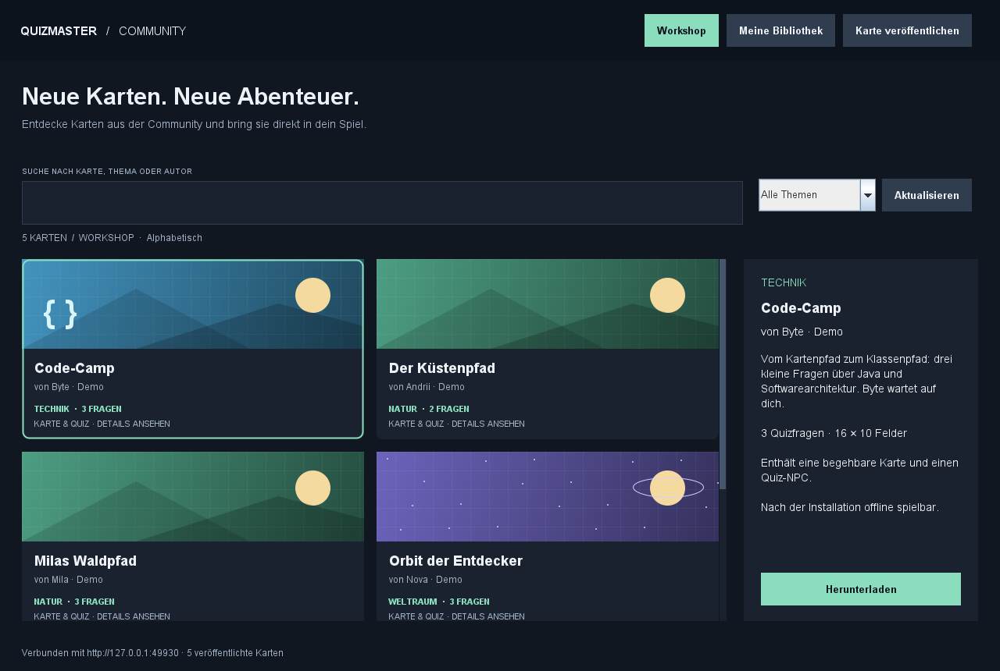

# QuizMaster Community Workshop

**Proof of Concept für Andrii Semenov · [SCRUM-40](https://softwareengineeringsite.atlassian.net/browse/SCRUM-40)**

Workshop bedeutet hier einen **gemeinsamen Katalog benutzererstellter Karten**, ähnlich dem Prinzip von [Steam Workshop](https://steamcommunity.com/workshop/) und der [osu!-Beatmap-Liste](https://osu.ppy.sh/beatmapsets). Der Workshop ist direkt in einer Java/Swing-Desktop-Anwendung integriert. Ein separater Java-Server speichert und verteilt die Karten; später kann dieser auf einem Heimserver laufen.



## Was funktioniert

1. Karten im gemeinsamen Serverkatalog entdecken, nach Titel/Autor suchen und nach Thema filtern.
2. Eine `.qmap`-Datei auswählen, prüfen und über **Karte veröffentlichen** an den Server senden.
3. Ein anderer Client aktualisiert den Workshop und sieht die Veröffentlichung.
4. **Herunterladen** legt das geprüfte Paket in seiner eigenen Bibliothek ab.
5. **Karte spielen** lädt die tatsächlich heruntergeladenen Felder, Hindernisse und NPC-Positionen.
6. Mit Pfeiltasten oder WASD zum NPC gehen; E, Leertaste oder der Interaktionsbutton startet das Quiz aus dem Kartenpaket.
7. Die installierte Karte bleibt nach einem Neustart und ohne Server spielbar. **Als Datei exportieren** ermöglicht auch den manuellen Austausch.

Die Beispieldaten sind als Demo-Autoren gekennzeichnet. Es gibt keine erfundenen Bewertungen, Downloadzahlen oder Online-Benutzer.

## Lokal starten (Windows)

Voraussetzung: **JDK 17 oder neuer**, `java` und `javac` im PATH. Getestet mit Temurin 21.0.7; kompiliert mit `--release 17`. Keine Maven-Abhängigkeiten erforderlich.

Aus dem Repository-Hauptverzeichnis zuerst den Server starten:

```powershell
.\ProofOfConceptAndriiSemenov\run.ps1 -Server
```

In einem zweiten Terminal den Desktop-Client starten:

```powershell
.\ProofOfConceptAndriiSemenov\run.ps1
```

Der Server hört standardmäßig auf **127.0.0.1:8765** und lädt vier Demokarten aus `samples/catalog/`. Das Terminal des Servers muss geöffnet bleiben. Mit Strg+C wird er beendet. Der Client läuft als separates Fenster.

Für einen zweiten Benutzer mit eigener Bibliothek in einem weiteren Terminal:

```powershell
.\ProofOfConceptAndriiSemenov\run.ps1 -Library data/client-b/library
```

Alle relativen Datenpfade beziehen sich auf diesen PoC-Ordner, da das Skript dorthin wechselt. Laufzeitdaten in `data/` und Compiler-Ausgaben in `out/` werden von Git ignoriert.

### Ohne PowerShell / in IntelliJ

Aus diesem PoC-Ordner:

```text
javac -encoding UTF-8 --release 17 -d out src/*.java
java -cp out WorkshopServer 127.0.0.1 8765 data/server samples/catalog
```

In einem zweiten Terminal:

```text
java -cp out Main http://127.0.0.1:8765 data/client/library
```

In IntelliJ `src` als Sources Root markieren und getrennte Run-Konfigurationen für `WorkshopServer.main()` und `Main.main()` anlegen. Working Directory: dieser PoC-Ordner. Die gleichen Argumente wie oben verwenden.

## Vorführung: zwei Benutzer tauschen eine Karte aus

1. Server und zwei Clients mit getrennten Bibliotheksordnern starten.
2. Client A: **Karte veröffentlichen** → `samples/upload/kuestenpfad.qmap` wählen → Vorschau bestätigen.
3. Client B: **Aktualisieren**, nach **Küsten** suchen. Die zuvor nicht im Startkatalog enthaltene Karte erscheint.
4. **Herunterladen** → **Meine Bibliothek** → **Karte spielen**.
5. Zweimal nach rechts gehen. Der goldene NPC Kai steht nun neben der Spielerfigur. **E** drücken.
6. Beide Fragen mit Antwort B beantworten: Ergebnis **2 / 2**.
7. Den Server stoppen. Die Karte aus der Bibliothek erneut öffnen: sie bleibt spielbar.
8. Server neu starten: die veröffentlichte Karte bleibt im gemeinsamen Katalog erhalten.

Identische Pakete werden anhand ihres SHA-256-Inhaltshashes dedupliziert. Ein erneuter Upload erzeugt keine zweite identische Karte. Geänderte Dateien erhalten eine neue ID; bestehende Veröffentlichungen werden nicht überschrieben.

## Später auf dem Heimserver

Der Client benötigt nur eine erreichbare Serveradresse. Beispiel mit einem Rechnernamen im Heimnetz:

```powershell
.\ProofOfConceptAndriiSemenov\run.ps1 -ServerUrl http://mein-heimserver:8765
```

Auf einem Windows-Heimserver bindet der Server an die Netzwerkschnittstellen:

```powershell
.\ProofOfConceptAndriiSemenov\run.ps1 -Server -BindAddress 0.0.0.0 -ServerData D:\QuizMaster\maps
```

Alternativ mit Java auf Linux, aus dem kompilierten PoC-Ordner:

```sh
java -cp out WorkshopServer 0.0.0.0 8765 /srv/quizmaster/maps samples/catalog
```

Der Zielordner muss für den Serverprozess schreibbar sein. Die Nutzer verbinden sich mit dem Hostnamen bzw. der tatsächlichen Adresse des Servers, **nicht mit `0.0.0.0`**. Der Port muss im verwendeten Netz erreichbar sein; dieser PoC verändert keine Firewall- oder Routereinstellungen.

### Gemeinsamer Zugangsschlüssel

Server und Clients unterstützen die Umgebungsvariable `QUIZMASTER_TOKEN`. Wenn sie am Server gesetzt ist, benötigen sowohl Katalogabruf als auch Upload und Download denselben Schlüssel. Er wird als Bearer-Token übertragen und weder in Karten noch im Repository gespeichert.

Für eine lokale Demo kann die Variable fehlen. Für eine Gruppe einen eigenen, zufälligen Schlüssel setzen und denselben Wert in den Umgebungen der Clients hinterlegen. Dies ist ein **Gruppenzugang**, kein Benutzerkonto- oder Autorennachweis.

### Docker als vorbereitete Hosting-Option

`Dockerfile` und `compose.yaml` starten ausschließlich den Server. Aus diesem Ordner, mit gesetzter Umgebungsvariable `QUIZMASTER_TOKEN`:

```sh
docker compose up -d --build
```

Das benannte Volume `workshop-maps` speichert die Karten unabhängig vom Container. Zur Sicherung dieses Volume bzw. bei direktem Java-Start den gewählten Datenordner sichern. `docker compose down` entfernt das benannte Volume standardmäßig nicht; `down -v` würde es löschen.

**Verifiziert:** Compose-Konfiguration ist syntaktisch gültig. **Nicht verifiziert:** Container-Build und Containerstart, da der lokale Docker Engine beim Test nicht lief. Der eigentliche Server wurde direkt mit Java getestet.

Für Zugriff über das öffentliche Internet fehlen in diesem PoC noch insbesondere HTTPS-Terminierung, individuelles Login/Autorisierung, Moderation und belastbare Betriebsgrenzen. Für einen späteren öffentlichen Heimserver diese Punkte ergänzen; der aktuelle Stand demonstriert einen kleinen gemeinsamen Workshop für eine vertrauenswürdige Gruppe. Bestehende Clients können bereits eine `https://`-Adresse verwenden.

## Architektur

```text
Desktop A (Swing)                    Desktop B (Swing)
  WorkshopUI                          WorkshopUI
       |                                   |
  WorkshopClient -- HTTP --> WorkshopServer <-- HTTP -- WorkshopClient
       |                    gemeinsamer Speicher                 |
  lokale Bibliothek           .qmap-Dateien                lokale Bibliothek
       |                                                        |
  MapUI -> QuizUI                                         MapUI -> QuizUI
```

| Baustein | Aufgabe |
|---|---|
| `WorkshopUI` | Katalog, Suche, Filter, Upload-Vorschau, Installation und Bibliothek; Netzwerkaktionen im SwingWorker |
| `WorkshopClient` | HTTP-Aufrufe, Zeitlimits, begrenzte Antwortgrößen und Prüfung heruntergeladener Pakete |
| `WorkshopServer` | Gemeinsamer Katalog und unveränderliche Uploads; optionaler Gruppenschlüssel |
| `WorkshopStore` | Getrennte serverseitige bzw. lokale Speicherung, Validierung, Hashprüfung und Dateiaustausch |
| `MapPackage` | Versioniertes Datenformat, Feldgrenzen, gültiges Terrain und erreichbarer NPC |
| `MapUI` | Bewegung, Kollisionen und NPC-Interaktion auf der geladenen Karte |
| `QuizService` / `QuizUI` | Bewertung bzw. Darstellung der aus dem Paket geladenen Fragen |

**Architekturstil:** Client-Server mit getrennter Präsentation, Anwendungslogik und Dateispeicherung. Ein einzelner kleiner Dienst genügt für den PoC. Es werden keine Microservices oder Datenbanken vorausgesetzt. Der Dateispeicher kann später hinter derselben HTTP-Schnittstelle ersetzt werden.

**API:** `GET /api/maps` liefert Katalogmetadaten, `POST /api/maps` nimmt ein Kartenpaket entgegen und gibt seine ID zurück, `GET /api/maps/{id}` liefert das Paket. Nutzdaten und Katalog verwenden UTF-8-Properties; das Paket enthält keine ausführbaren Inhalte. Details: [Kartenformat](docs/FORMAT.md).

## Prüfungen

```powershell
.\ProofOfConceptAndriiSemenov\run.ps1 -Test
.\ProofOfConceptAndriiSemenov\run.ps1 -Test -Screenshots
```

Die Tests starten einen echten HTTP-Server auf einem zufällig vergebenen Loopback-Port und zwei unabhängige Clients. Sie benötigen lokale Netzwerkverbindungen, aber keinen externen Server. Testdaten werden in einem eigenen temporären Unterordner von `out/` angelegt und danach entfernt.

**Prüfergebnis vom 06.11.2026:** 38 Quiz-/Swing-Prüfungen und 48 Workshop-Prüfungen bestanden, insgesamt **86**.

Abgedeckt sind Quizbewertung, ungültige Zustandswechsel, doppelte Abgabe, Paketvalidierung auf Client **und Server**, Größenlimits, ungültige IDs, Upload/Deduplizierung, Download, unabhängige Bibliotheken, Server-/Client-Neustart, Zugangsschlüssel, Suche und Installation über Swing-Buttons, Kollisionen, NPC-Interaktion, geladene Quizfragen sowie Offline-Spiel.

Die Screenshot-Dateien werden aus den tatsächlichen Swing-Komponenten gerendert. Zusätzlich wurde das echte Desktop-Fenster mit geladenem Serverkatalog gestartet und visuell geprüft. Die automatisierte Windows-Klickeingabe scheiterte am Computer-Use-Helfer (`SendInput`, Fehler 122); die Interaktionen wurden über Swing-Komponententests geprüft. Tastaturbedienung im echten Fenster bleibt manuell nachzuprüfen.

| Ansicht | Bild |
|---|---|
| Gemeinsamer Workshop | [01-workshop.png](docs/screenshots/01-workshop.png) |
| Installierte Karte | [02-library.png](docs/screenshots/02-library.png) |
| Begehbare Karte und NPC | [03-map.png](docs/screenshots/03-map.png) |
| Quiz aus dem Kartenpaket | [04-quiz.png](docs/screenshots/04-quiz.png) |
| Ergebnis | [05-result.png](docs/screenshots/05-result.png) |
| Offline-Spiel | [06-offline-map.png](docs/screenshots/06-offline-map.png) |

## Einordnung in das Repository und Grenzen

Die bestehenden PoCs von Matthias (Swing) und Betsabe (interaktive Oberfläche) sowie `main`-Stand `765bc0e` wurden als Ausgangspunkt geprüft. Dieser Beitrag bleibt wie die anderen PoCs **eigenständig startbar**. Das vorhandene `QuizMaster`-Maven-Projekt enthält noch unimplementierte Map-/Bewegungsmethoden; seine Klassen und Java-25-Konfiguration wurden nicht geändert. Die Integration in dessen späteren Spielkern erfolgt über die Pakete/HTTP-Schnittstelle und die Zuordnung von Terrain, NPC, Position und Quiz.

Der PoC verbindet das Karten-/NPC-Konzept mit Import/Export und Quizspielen aus der SRS. Ein grafischer Karteneditor ist noch nicht enthalten: eigene Karten lassen sich durch Bearbeiten einer Beispiel-`.qmap` erstellen und dann veröffentlichen. Pro Karte gibt es derzeit einen NPC und 1-10 Single-Choice-Fragen mit je vier Antworten. Weitere Kartentypen, mehrere NPCs, Vorschau-Bilder, Bewertungen, automatische Updates, Löschen von Veröffentlichungen und individuelle Konten sind spätere Erweiterungen. Maximal 100 Karten je Speicher, 64 KiB je Paket.

Die Karten-Cover sind lokal gezeichnete Themenillustrationen, keine Screenshots der jeweiligen Spielkarte. Das vorangegangene reine Naturquiz wurde zum Player der heruntergeladenen Karten weiterverwendet; es ist nicht mehr der Einstieg der Anwendung.

Es wurden keine Commits erstellt und keine Inhalte in Jira, GitHub oder einem öffentlichen Workshop veröffentlicht. Alle automatisierten Uploads gingen ausschließlich an den eigenen temporären Loopback-Testserver.

