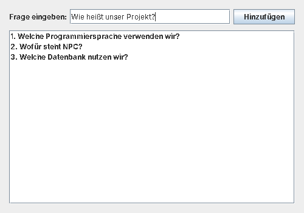

# Proof of Concept: Quiz-Editor (Hello World)

**Nevval · Bereich: Quiz-Editor / Geschäftslogik ([SCRUM-7](https://softwareengineeringsite.atlassian.net/browse/SCRUM-7))**

Hello-World-Programm in Java Swing, mit dem ich zeige, dass meine Entwicklungsumgebung für den Quiz-Editor funktioniert.
Man gibt eine Frage ein, klickt auf **Hinzufügen**, und die Frage erscheint in der Liste.



## Aufbau

| Klasse | Aufgabe |
|---|---|
| `QuizEditorService` | Logik: speichert die Fragen und lehnt leere Eingaben ab |
| `QuizEditorUI` | Swing-Fenster mit Eingabefeld, Button und Liste |
| `Main` | Startet das Programm |

## Starten

In IntelliJ `Main.main()` ausführen, oder im Terminal aus diesem Ordner:

```text
javac -encoding UTF-8 -d out src/*.java
java -cp out Main
```
