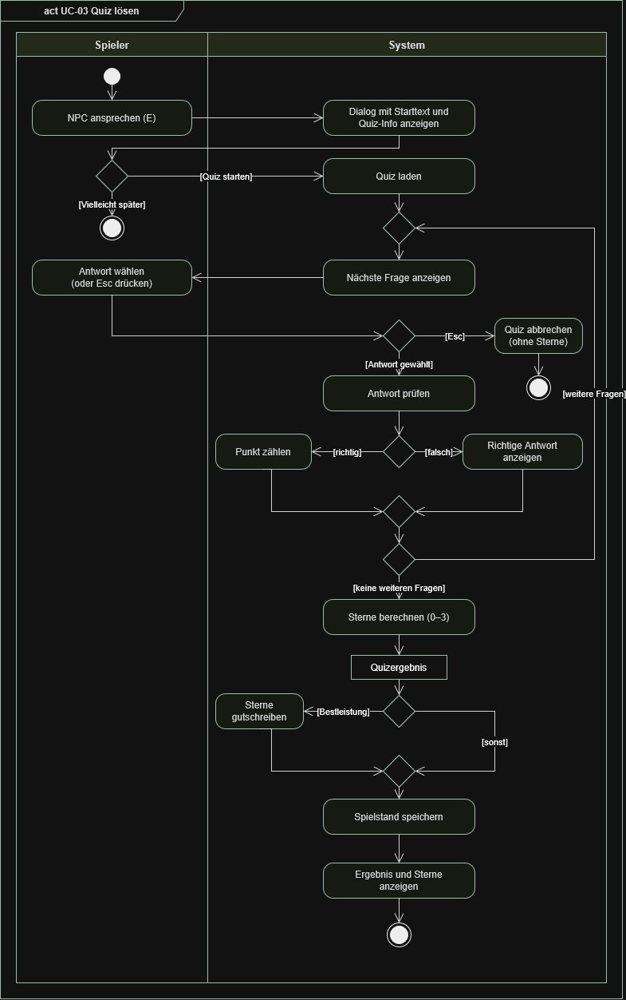
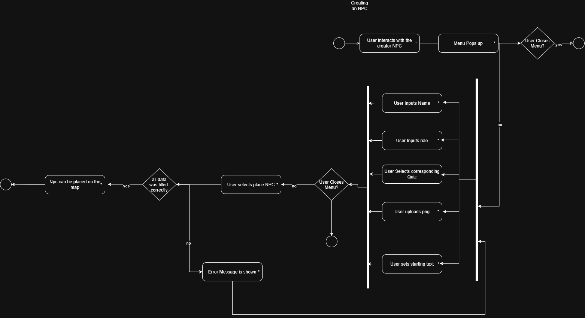
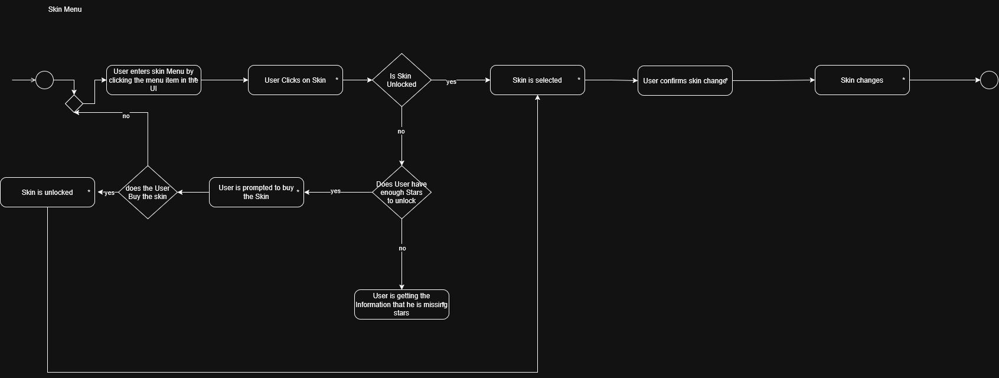

# Softwareanforderungsspezifikation (SRS) – DHBW Quizgame

| Dokumentinformation | Wert |
|---|---|
| Projekt | DHBW Quizgame – Quizbasiertes Lernspiel mit begehbarer Spielwelt |
| Lehrveranstaltung | Grundlagen des Software Engineering, DHBW Karlsruhe |
| Version | **0.6, Reviewfassung – 26.10.2026 (Blog 3 / Aufgabe C und E)** |
| Schwerpunkt | **Kapitel 2: Funktionale Anforderungen, Use Cases und UML-Verhaltensmodellierung** gemäß Vorlesung vom 20.10.2026 |
| Status | Prüffassung; Implementierungsstand wird nicht vorausgesetzt |

## 1. Einleitung

### 1.1 Übersicht

**DHBW Quizgame** ist ein geplantes, lokal nutzbares Lernspiel, das thematische Quizmodule mit der Erkundung einer 2D-Spielwelt verbindet. Die Spielerfigur bewegt sich zu NPCs, über die Quizmodule ausgewählt und bearbeitet werden. Ein Benutzer kann zudem eigene Quizmodule und NPCs erstellen und über Dateien austauschen. Die spielerische Darstellung orientiert sich an Retro-RPGs; das vorhandene Menü-/NPC-Design ist in Figma dokumentiert.

**Stakeholder:** Spieler/Lernende, Benutzer mit der Rolle „Quiz-Ersteller“, das Projektteam und der betreuende Lehrende. „Quiz-Ersteller“ bezeichnet eine Nutzungsrolle, **kein** bestätigtes getrenntes Benutzerkonto.

### 1.2 Geltungsbereich

**Teil des geplanten Funktionsumfangs:** 2D-Spielwelt und NPC-Interaktion, Auswahl und Bearbeitung thematischer Quizmodule, Fragetypen Multiple Choice/Freitext/Zahl, optionales Bild und Hinweise, Punkte, Modul-/NPC-Erstellung, lokal gespeicherte Inhalte, Import und Export, mehrere Demonstrationsmodule.

**Nicht verbindlich für die erste Version:** Cloud-Hosting, PostgreSQL-Deployment, Online-Mehrspielerbetrieb und Online-Synchronisierung. Visuell gezeigte Sterne, Quests, Einstellungen oder automatische Fortschrittsspeicherung sind noch als Vorschläge zu bestätigen.

### 1.3 Definitionen, Akronyme und Abkürzungen

| Begriff | Erläuterung |
|---|---|
| SRS | Software Requirements Specification; Softwareanforderungsspezifikation |
| UML | Unified Modeling Language |
| Use Case / Anwendungsfall | Aus Sicht eines Akteurs sinnvolle Interaktion mit dem System zur Erreichung eines Ziels |
| GUI | Graphical User Interface, grafische Benutzeroberfläche |
| NPC | Non-Player Character / Nichtspielercharakter |
| Quizmodul | Thematisch zusammengehörige Quizfragen, optional mit Bildern/Hinweisen/Zwischentexten |
| Quiz-Ersteller | Rolle des Benutzers beim Anlegen und Teilen von Inhalten |
| SQLite | Lokale relationale Datenbank des Erstsystems |
| FA | Identifikator einer funktionalen Einzelanforderung |
| UC | Identifikator eines Anwendungsfalls |

### 1.4 Referenzen

1. **Vorlesung:** Harald Ichters, *Funktionale Anforderungsanalyse – UML Verhaltensdiagramme*, DHBW Karlsruhe, Fassung vom 20.10.2026; besonders Folien 22–24 (Use Cases), 26–35 (Aktivitätsdiagramme), 36–41 (Sequenzdiagramme).
2. **Aufgabenblatt:** *Aufgabenblatt 04 – UML Verhaltensdiagramme (Blog 3)*, 20.10.2026; Aufgabe C: mindestens fünf Use Cases und Einbettung der in A und B erstellten Diagramme mit Erläuterung.
3. **UML-Teamübersicht:** [UML_Diagramm.drawio](https://github.com/Styximus/Software-Engineering/blob/main/UML_Diagramm.drawio).
4. **Verfügbare Aktivitätsmodelle:** [Quizablauf (Team, draw.io)](https://github.com/Styximus/Software-Engineering/blob/main/docs/uml/Quiz_Altivitätsdiagramm.drawio), [NPC-Erstellung (Team, draw.io)](https://github.com/Styximus/Software-Engineering/blob/main/docs/uml/NPCCreation%281%29.drawio), [Quizmodul erstellen (ergänzende Quelle)](uml/demo/UC03_Aktivitaet_Quizmodul_erstellen.drawio); [Skin-Menü (Team)](https://github.com/Styximus/Software-Engineering/blob/main/docs/uml/SkinMenu.drawio) als optionale spätere Funktion.
5. **Jira-User-Stories:** [SCRUM-6](https://softwareengineeringsite.atlassian.net/browse/SCRUM-6), [SCRUM-7](https://softwareengineeringsite.atlassian.net/browse/SCRUM-7), [SCRUM-8](https://softwareengineeringsite.atlassian.net/browse/SCRUM-8), [SCRUM-9](https://softwareengineeringsite.atlassian.net/browse/SCRUM-9), [SCRUM-10](https://softwareengineeringsite.atlassian.net/browse/SCRUM-10).
6. **Verbindliche Designreferenz:** [Original: Menü-Mockup in Figma](https://www.figma.com/design/YkwCZacuoRePduhsts6pTt/Men%C3%BC-Mockup?node-id=0-1&t=jgPMQzG9T4ny4CIw-1). Die unveränderte Originaldatei ist zu verwenden; die Zugriffskopie diente nur zur Einsicht.
7. **Projektidee:** [GitHub Discussion #1](https://github.com/Styximus/Software-Engineering/discussions/1) (Volltext noch nicht geprüft).
8. **Kursvorlage:** Moodle `SoftwareAnforderungsspezifikation.md` (Datei liegt hier nicht vor; exakte Layout-Übereinstimmung nicht geprüft).
9. **Sequenzdiagramme:** [UC-02](uml/demo/UC02_Sequenz_Quiz_spielen.drawio) und [UC-04](uml/demo/UC04_Sequenz_NPC_erstellen.drawio) als bearbeitbare Modelle in `docs/uml/demo/`.

## 2. Funktionale Anforderungen

### 2.1 Gesamtübersicht und Anwendungsfalldiagramm

Die folgenden **sechs Kern-Anwendungsfälle (UC-01 bis UC-06)** beschreiben das beobachtbare Verhalten des Quizgames. Der Akteur *Spieler* kann auch in der Nutzungsrolle *Quiz-Ersteller* handeln; ein separates Benutzerkonto ist dafür nicht gefordert.

**Übergeordnetes Anwendungsfalldiagramm der Projektgruppe:** [UML_Diagramm.drawio – editierbare Originaldatei](../UML_Diagramm.drawio) ([GitHub-Vorschau/Download](https://github.com/Styximus/Software-Engineering/blob/main/UML_Diagramm.drawio)). Dieses Teamdiagramm zeigt neben den Kernfunktionen auch Elemente wie *Stars*, *Player skins* und *Skin Menu*. Diese bleiben **optionale spätere Erweiterungen**, soweit sie nicht ausdrücklich als Kernanforderung beschrieben sind.

**Abgrenzung der Diagrammtypen:** Das übergeordnete **Anwendungsfalldiagramm** zeigt, *welche Ziele* die Benutzer verfolgen. Die **Aktivitätsdiagramme** konkretisieren die möglichen Arbeitsschritte und Entscheidungszweige eines Anwendungsfalls. Die **Sequenzdiagramme** ergänzen diese Ablaufsicht durch die zeitliche Kommunikation zwischen Akteur, Benutzeroberfläche und beteiligten Systemkomponenten. Die Diagramme werden jeweils unmittelbar beim zugehörigen UC referenziert.

**UI-Mockup:** [Original-Menü-Mockup in Figma](https://www.figma.com/design/YkwCZacuoRePduhsts6pTt/Men%C3%BC-Mockup?node-id=0-1&t=jgPMQzG9T4ny4CIw-1), einschließlich „Startmenü · Wissensinsel“ und „NPC-Dialog · Milas Naturquiz“. Die Figma-Kopie ist keine zweite Designvorgabe.

**Anforderungsquellen:** [SCRUM-6](https://softwareengineeringsite.atlassian.net/browse/SCRUM-6) bis [SCRUM-10](https://softwareengineeringsite.atlassian.net/browse/SCRUM-10). Die Zuordnung steht in Abschnitt 2.4.

### 2.2 Tabellarische Beschreibungen der Anwendungsfälle

Die Tabellen folgen den Merkmalen der Vorlesung: Name, Akteur, Annahmen, Vor- und Nachbedingungen, Ausnahmen, Daten, Auslöser, Systemantwort und offene Punkte. Die Abschnitte **„Verhaltensmodellierung und Zusammenhang“** stellen jeweils die Verbindung zwischen Textbeschreibung, Aktivitätsdiagramm und gegebenenfalls Sequenzdiagramm her. Die Diagramme beschreiben Entwurfsabläufe; daraus werden keine über die Jira-Stories hinausgehenden Basisanforderungen abgeleitet. Noch nicht dargestellte Funktionen bleiben textuell spezifiziert.

#### 2.2.1 Spielwelt erkunden und NPC ansprechen

| Merkmal | Beschreibung |
|---|---|
| Name | **UC-01 – Spielwelt erkunden und NPC ansprechen** |
| Akteur | Spieler |
| Beschreibung / Ziel | Der Spieler bewegt seine Spielfigur durch eine Karte und öffnet die Unterhaltung mit einem erreichbaren NPC. |
| Annahmen | Die Anwendung verfügt über eine initiale Spielkarte mit mindestens einem NPC. |
| Vorbedingungen | Die Spielwelt ist geöffnet; Spielerfigur und NPC sind sichtbar. |
| Auslöser | Der Spieler steuert seine Figur und betätigt in der Nähe eines NPC die Interaktionstaste. |
| Hauptablauf | 1. Das System zeigt die Karte und die Spielfigur. 2. Der Spieler bewegt sich zu einem NPC. 3. Der Spieler löst die Interaktion aus. 4. Das System öffnet den entsprechenden NPC-Dialog. |
| Nachbedingungen | Der NPC-Dialog ist sichtbar; die Spielfigur bleibt in der Spielwelt erhalten. |
| Ausnahmen | Befindet sich kein NPC in Interaktionsreichweite, wird kein fremder Dialog geöffnet. |
| Daten | Spielerposition, NPC-Konfiguration, Tastatureingabe. |
| Antwort des Systems | Ein geöffnetes Dialogfenster mit Informationen zum NPC und ggf. einem Quizangebot. |
| Zukünftige Verbesserungen | Zusätzliche Gebiete oder alternative Eingabegeräte sind denkbar, aber nicht beschlossen. |
| Offene Punkte | Steuerungskonflikt: SCRUM-6 fordert Pfeiltasten/Leertaste; Figma zeigt WASD/E. Reichweite und Kollisionsregeln noch nicht definiert. |
| Jira / Anforderungen | [SCRUM-6](https://softwareengineeringsite.atlassian.net/browse/SCRUM-6); FA-001 bis FA-004 |

**Verhaltensmodellierung und Zusammenhang:** Die Systemgrenze und die NPC-Interaktion sind im übergeordneten Team-Anwendungsfalldiagramm skizziert. Ein zusätzliches Aktivitäts- oder Sequenzdiagramm zu UC-01 liegt nicht vor; dieser Use Case ist deshalb vorerst allein über Hauptablauf, Vorbedingungen und die Ausnahme „kein NPC erreichbar“ konkretisiert. Die Anforderungen SCRUM-6 und FA-001 bis FA-004 bestimmen den verpflichtenden Teil.

#### 2.2.2 Quizmodul spielen

| Merkmal | Beschreibung |
|---|---|
| Name | **UC-02 – Quizmodul spielen** |
| Akteur | Spieler |
| Beschreibung / Ziel | Der Spieler wählt beim NPC ein Quizmodul aus und beantwortet die enthaltenen Fragen. |
| Annahmen | Mindestens ein spielbares Modul ist vorhanden und einem NPC zugeordnet. |
| Vorbedingungen | Das Modul steht über den NPC-Dialog bzw. das Modulmenü zur Auswahl. |
| Auslöser | Der Spieler betätigt „Quiz starten“ beziehungsweise die entsprechende Auswahlaktion. |
| Hauptablauf | 1. Das System öffnet die Quizansicht. 2. Das System zeigt eine Frage mit dem zugehörigen Antwortformat. 3. Der Spieler gibt eine Antwort ein und setzt das Quiz fort. 4. Das System verarbeitet die Antwort entsprechend dem konfigurierten Fragetyp. 5. Nach der Bearbeitung kann der Spieler zum Modulmenü zurückkehren. |
| Nachbedingungen | Die Antworten werden verarbeitet; der Spieler kann die Quizansicht wieder verlassen. Eine gesonderte Ergebnisübersicht mit Sternen gehört nicht zu den bestätigten Kernfunktionen. |
| Ausnahmen | Ein unvollständiges oder fehlerhaftes Modul darf nicht unbemerkt als vollständiges Quiz dargestellt werden. Verhalten beim Abbruch ist offen. |
| Daten | Quizfragen, Antwortoptionen, Bilder, Hinweise, Eingaben und Punktwerte. |
| Antwort des Systems | Eine zur Frage passende Quizansicht und die Verarbeitung der Antworten. |
| Zukünftige Verbesserungen | Ergebnisübersicht und persistente Statistik sind mögliche Erweiterungen; nur die Ergebnisübersicht ist bereits als optionale Ergänzung formuliert. |
| Offene Punkte | Auswertungsregeln für Mehrfachauswahl, Freitext, Zahlen, Teilpunkte und Hinweise sowie Verhalten bei Abbruch entscheiden. |
| Jira / Anforderungen | [SCRUM-6](https://softwareengineeringsite.atlassian.net/browse/SCRUM-6), [SCRUM-7](https://softwareengineeringsite.atlassian.net/browse/SCRUM-7), [SCRUM-8](https://softwareengineeringsite.atlassian.net/browse/SCRUM-8); FA-006 bis FA-015 |

**UML-Aktivitätsdiagramm – Quiz spielen (Teamquelle):**

[Originaldiagramm bearbeiten: Quiz_Altivitätsdiagramm.drawio](uml/Quiz_Altivitätsdiagramm.drawio)

**UML-Sequenzdiagramm – Quiz spielen (ergänzende Reviewquelle):**

[Bearbeitbare draw.io-Quelle](uml/demo/UC02_Sequenz_Quiz_spielen.drawio)

**Zusammenfassung und Zusammenhang:** Beide Modelle konkretisieren **UC-02** aus zwei Blickwinkeln. Im Team-Aktivitätsdiagramm betritt der Spieler über einen NPC-Dialog das Quiz, lädt Fragen, wählt Antworten und verzweigt bei „Esc“, „richtig/falsch“ sowie „weitere Fragen/keine weiteren Fragen“. Das Sequenzdiagramm zeigt dazu die zeitliche Zusammenarbeit von *Spieler*, *NPC-Dialog*, *Quizoberfläche*, *Quizsteuerung* und *Modulablage*: Startanforderung, Modul laden, gültige Daten prüfen, Fragen in einer Schleife darstellen, Antworten übertragen und zur Modulauswahl zurückkehren. Der Fehlerpfad für ungültige Module ist in beiden Sichtweisen relevant.

**Abweichungen / Abgrenzung:** Die originale Team-Aktivitätsgrafik trägt die Überschrift **„UC-03 Quiz lösen“**, obwohl Quizspielen in der SRS **UC-02** ist; dies ist eine Benennungsabweichung, **keine Umnummerierung der SRS**. Ferner enthält die Grafik „Sterne berechnen“, „Sterne gutschreiben“ und „Spielstand speichern“. Solche Fortschrittsfunktionen bleiben **optionale spätere Erweiterungen** und dürfen nicht als bereits verpflichtend oder implementiert verstanden werden. Die verbindliche Quizdurchführung umfasst dagegen das Laden, Anzeigen und Verarbeiten von Fragen sowie die Navigation zur Modulauswahl. Die genaue Antwortbewertung ist noch fachlich zu spezifizieren.

#### 2.2.3 Quizmodul erstellen

| Merkmal | Beschreibung |
|---|---|
| Name | **UC-03 – Quizmodul erstellen** |
| Akteur | Quiz-Ersteller (Spieler in der Erstellerrolle) |
| Beschreibung / Ziel | Der Benutzer legt ein thematisches Quizmodul mit Fragen aus vordefinierten Vorlagen an. |
| Annahmen | Ein grafischer Quiz-Editor und lokale Datenhaltung sind vorgesehen. |
| Vorbedingungen | Der Benutzer hat den Editor geöffnet (laut SCRUM-9 über einen Customizer-NPC). |
| Auslöser | Der Benutzer wählt „Modul erstellen“ oder eine entsprechende Editorfunktion. |
| Hauptablauf | 1. Ein Modul mit Thema/Kategorie wird angelegt. 2. Der Benutzer fügt passende Fragen und optionale Bilder, Hinweise sowie Zwischentexte hinzu. 3. Er legt Punkte und ggf. Zufallsreihenfolge fest. 4. Er speichert das Modul. |
| Nachbedingungen | Ein gespeichertes Quizmodul ist nach erneutem Öffnen zur Auswahl verfügbar. |
| Ausnahmen | Ungültige oder unvollständige Eingaben müssen vor dem Speichern behandelt werden; Art der Validierung ist noch nicht vereinbart. |
| Daten | Kategorie, Fragen, richtige Antworten, optionale Medien, Hinweise, Punktwerte und Zufallsoption. |
| Antwort des Systems | Ein gespeichertes und später ausführbares Quizmodul. |
| Zukünftige Verbesserungen | Spätere Online-Verwaltung von Modulen ist nicht Bestandteil der Erstversion. |
| Offene Punkte | Pflichtfelder, Detailregeln für Antworten, Dateiformate und Validierung abstimmen. |
| Jira / Anforderungen | [SCRUM-7](https://softwareengineeringsite.atlassian.net/browse/SCRUM-7), [SCRUM-9](https://softwareengineeringsite.atlassian.net/browse/SCRUM-9); FA-005, FA-016 bis FA-020, FA-028 |

**UML-Aktivitätsdiagramm – Quizmodul erstellen (ergänzende Reviewquelle):**

[Bearbeitbare draw.io-Quelle](uml/demo/UC03_Aktivitaet_Quizmodul_erstellen.drawio)

**Zusammenfassung und Zusammenhang:** Das Diagramm konkretisiert **UC-03** als Ablauf mit wiederholter Eingabe von Fragen: Editor öffnen, Titel/Kategorie und Fragetyp festlegen, Fragen und Antworten samt Punkten erfassen, gegebenenfalls Bilder/Hinweise/Zwischentexte ergänzen und für jede weitere Frage in die Eingabe zurückkehren. Nach der Einstellung der Zufallsreihenfolge prüft das System die Moduldaten. Ungültige Eingaben führen zur Korrektur, gültige zur lokalen Speicherung und Bereitstellung in der Modulauswahl. Ein eigener Fehlerpfad behandelt gescheiterte Speichervorgänge. Diese Verzweigungen illustrieren die Ausnahmebedingungen und Nachbedingungen in der Tabelle; sie sind keine zusätzlichen Implementierungsvorgaben für eine konkrete Java-Klassenstruktur.

#### 2.2.4 NPC erstellen und Quiz zuordnen

| Merkmal | Beschreibung |
|---|---|
| Name | **UC-04 – NPC erstellen und Quiz zuordnen** |
| Akteur | Quiz-Ersteller (Spieler in der Erstellerrolle) |
| Beschreibung / Ziel | Der Benutzer erstellt einen NPC mit PNG-Grafik und ordnet ihm ein selbst erstelltes Quiz zu. |
| Annahmen | Eine Erstellungsoberfläche und ein vorhandenes oder neu angelegtes Quizmodul sind verfügbar. |
| Vorbedingungen | Der Customizer-NPC bzw. eine entsprechende Bearbeitungsansicht ist geöffnet. |
| Auslöser | Der Benutzer startet das Anlegen eines NPC. |
| Hauptablauf | 1. Der Benutzer interagiert mit dem Creator-NPC; das Erstellungsmenü öffnet sich. 2. Er gibt einen Namen und eine Rolle ein, wählt ein vorhandenes Quizmodul, lädt eine PNG-Grafik hoch und hinterlegt einen Starttext. 3. Er wählt einen Platz für den NPC auf der Karte. 4. Die Eingaben werden geprüft; bei gültigen Daten wird der NPC zur Platzierung bereitgestellt. Die konkrete dauerhafte Speicherung bleibt der SRS-Anforderung entsprechend erforderlich, ist aber in der aktuellen Aktivitätsgrafik nicht ausdrücklich dargestellt. |
| Nachbedingungen | Der NPC ist gespeichert und sein zugeordnetes Quiz kann über ihn gestartet werden. |
| Ausnahmen | Der Benutzer kann das Menü schließen, ohne den NPC anzulegen. Sind erforderliche Daten unvollständig oder ungültig, sieht das Aktivitätsmodell eine Fehlermeldung vor. Ein fehlerhafter NPC darf nicht als erfolgreich erstellt gelten. |
| Daten | NPC-Name, Rolle, Starttext, PNG-Grafik, Referenz auf das Quizmodul und gewünschte Position auf der Karte. |
| Antwort des Systems | Ein verfügbarer, ansprechbarer NPC mit zugeordnetem Quiz. |
| Zukünftige Verbesserungen | NPC-Animationen oder komplexe Dialogbäume sind nicht vereinbart. |
| Offene Punkte | Zulässige Positionen in der Spielwelt, erlaubte Bildgrößen, Anzahl von Modulen je NPC sowie die explizite Speicherung nach erfolgreicher Validierung spezifizieren. |
| Jira / Anforderungen | [SCRUM-7](https://softwareengineeringsite.atlassian.net/browse/SCRUM-7), [SCRUM-9](https://softwareengineeringsite.atlassian.net/browse/SCRUM-9); FA-020 bis FA-023 |

**UML-Aktivitätsdiagramm (vorhanden):**

[Editierbare Originaldatei: NPCCreation(1).drawio](uml/NPCCreation%281%29.drawio) · [Ansicht in GitHub](https://github.com/Styximus/Software-Engineering/blob/main/docs/uml/NPCCreator.drawio.png)

**UML-Sequenzdiagramm – NPC erstellen (ergänzende Reviewquelle):**

[Bearbeitbare draw.io-Quelle](uml/demo/UC04_Sequenz_NPC_erstellen.drawio)

**Zusammenfassung und Zusammenhang:** Das Aktivitätsdiagramm detailliert den oben beschriebenen UC-04. Die Interaktion mit dem Creator-NPC öffnet zunächst das Menü; anschließend wird zwischen Schließen und Weiterbearbeiten unterschieden. Bei der Erstellung erfasst der Benutzer **Name, Rolle, zugehöriges Quiz, PNG und Starttext** und wählt einen Ort in der Spielwelt. Der Entscheidungszweig **„all data was filled correctly“** führt je nach Gültigkeit zur weiteren NPC-Platzierung oder zu einer Fehlermeldung. Das ergänzt die Haupt- und Ausnahmeabläufe in der Tabelle. Die Grafik beschreibt dabei primär **die Reihenfolge der Aktivitäten**, nicht die technische Datenübertragung. Das ergänzende **Sequenzdiagramm** zeigt dieselbe Interaktion als Nachrichtenfolge zwischen Spieler, NPC-Editor, Validierung und Datenhaltung: Eingaben erfassen, PNG/Quizreferenz prüfen, bei gültigem Modell speichern und den NPC der Welt zur Verfügung stellen; bei Fehlern wird die Erstellung nicht als erfolgreich bestätigt. Die beiden Diagramme decken damit Kontrollfluss und Kommunikation desselben Use Cases ab. Das teamseitige Aktivitätsdiagramm zeigt die dauerhafte Speicherung nicht explizit; das Sequenzdiagramm erläutert diese durch das SRS geforderte Nachbedingung als ergänzende Modellsicht.

**Hinweis zur Überprüfung:** Die Diagrammquelle verwendet Entscheidungen und `yes`/`no`-Zweige. Für eine formale UML-Prüfung sollte kontrolliert werden, dass Start-/Endknoten, Kanten und Entscheidungspfade eindeutig verbunden und die Guards konsistent sind.

#### 2.2.5 Quizmodule und NPCs exportieren

| Merkmal | Beschreibung |
|---|---|
| Name | **UC-05 – Quizmodule und NPCs exportieren** |
| Akteur | Quiz-Ersteller (Spieler in der Erstellerrolle) |
| Beschreibung / Ziel | Der Benutzer exportiert ein eigenes Quizmodul oder einen NPC in eine Datei zur Weitergabe. |
| Annahmen | Das zu exportierende Element ist lokal vorhanden und gespeichert. |
| Vorbedingungen | Der Benutzer öffnet die Exportfunktion für ein ausgewähltes Element. |
| Auslöser | Der Benutzer wählt den Export eines Moduls oder NPC. |
| Hauptablauf | 1. Das System bestimmt die zu exportierenden Daten. 2. Es erzeugt eine Datei oder ein Paket. 3. Es stellt das Exportergebnis zur Weitergabe bereit. |
| Nachbedingungen | Ein exportiertes Element kann grundsätzlich durch die vorgesehene Importfunktion wieder eingelesen werden. |
| Ausnahmen | Fehler beim Dateizugriff oder unvollständige Inhalte werden nicht als erfolgreicher Export gemeldet. |
| Daten | Modul- oder NPC-Daten, zugehörige Bilder und Konfiguration. |
| Antwort des Systems | Ein exportierbares Dateiartefakt. |
| Zukünftige Verbesserungen | Cloud-Synchronisation ist nicht Bestandteil der Erstversion. |
| Offene Punkte | Dateiformat, Versionierung, Pfade und Behandlung referenzierter Medien festlegen. |
| Jira / Anforderungen | [SCRUM-10](https://softwareengineeringsite.atlassian.net/browse/SCRUM-10); FA-024, FA-026 |

**Verhaltensmodellierung und Zusammenhang:** Der Kern ist die Folge „Objekt wählen → referenzierte Daten und Bilder zusammenstellen → Exportdatei erzeugen → Datei bereitstellen“. Ein Aktivitätsdiagramm kann insbesondere fehlende Medien und Dateifehler behandeln; ein Sequenzdiagramm würde das Zusammenspiel zwischen Exportoberfläche, Datenhaltung und Dateisystem erklären. **Für UC-05 wurde kein eigenes Verhaltensdiagramm erstellt; der beschriebene Kernablauf bleibt textuell spezifiziert.** Ein bestimmtes Paketformat (z. B. JSON oder ZIP) wird hier nicht vorweggenommen.

#### 2.2.6 Quizmodule und NPCs importieren

| Merkmal | Beschreibung |
|---|---|
| Name | **UC-06 – Quizmodule und NPCs importieren** |
| Akteur | Quiz-Ersteller (Spieler in der Erstellerrolle) |
| Beschreibung / Ziel | Der Benutzer übernimmt eine von einem anderen Benutzer erhaltene Exportdatei in den lokalen Datenbestand. |
| Annahmen | Die Anwendung verfügt über eine Importfunktion und einen beschreibbaren lokalen Datenspeicher. |
| Vorbedingungen | Eine vom System unterstützte Datei liegt vor. |
| Auslöser | Der Benutzer wählt eine Datei zur Übernahme. |
| Hauptablauf | 1. Das System liest die Datei. 2. Es prüft die enthaltenen Daten. 3. Es übernimmt einen gültigen Quiz- bzw. NPC-Datensatz in die lokale Datenhaltung. 4. Es macht ihn in der Modulauswahl beziehungsweise bei den NPCs verfügbar. |
| Nachbedingungen | Ein gültig importiertes Objekt ist anschließend nutzbar. |
| Ausnahmen | Bei ungültigen Formaten, fehlenden Medien oder Datenkonflikten wird kein unbemerkter Teilimport als Erfolg ausgegeben; konkrete Konfliktstrategie ist offen. |
| Daten | Datei mit Modul- oder NPC-Konfiguration und zugehörigen Medien. |
| Antwort des Systems | Ein lokal verfügbares importiertes Modul oder ein importierter NPC. |
| Zukünftige Verbesserungen | Direkter Online-Austausch ist nicht vorgesehen. |
| Offene Punkte | Dateiformat, Umgang mit Namens-/ID-Konflikten und NPC-Platzierung klären. |
| Jira / Anforderungen | [SCRUM-10](https://softwareengineeringsite.atlassian.net/browse/SCRUM-10); FA-025, FA-027, FA-030 |

**Verhaltensmodellierung und Zusammenhang:** Der beschriebene Ablauf führt von der Auswahl einer Datei über Prüfung und Datenübernahme bis zur Anzeige des importierten Objekts. Als Abzweigungen kommen ungültige Dateien, fehlende Medien und Datenkonflikte in Frage. Ein Aktivitätsdiagramm könnte die Kontrollflüsse erläutern, ein Sequenzdiagramm die Kommunikation zwischen Importoberfläche, Datenprüfung und lokalem Speicher. **Für UC-06 wurde kein eigenes Verhaltensdiagramm erstellt; der beschriebene Kernablauf bleibt textuell spezifiziert.** Die exakte Fehler- und Konfliktstrategie bleibt offen.

#### 2.2.7 Zuordnung von Anwendungsfällen und Verhaltensdiagrammen (26.10.2026)

| Anwendungsfall | Aktivitätsdiagramm | Sequenzdiagramm | Umfang |
|---|---|---|---|
| UC-01 – Spielwelt erkunden und NPC ansprechen | – | – | Kernumfang; textuell beschrieben |
| **UC-02 – Quizmodul spielen** | **[Teamaktivitätsdiagramm](uml/Quiz_Altivitätsdiagramm.drawio)** ([PNG](uml/QuizAktivitätsdiagramm.drawio.png)) | **[Sequenzdiagramm](uml/demo/UC02_Sequenz_Quiz_spielen.drawio)** ([SVG](uml/demo/UC02_Sequenz_Quiz_spielen.svg)) | **Kernumfang; beide erläutert** |
| **UC-03 – Quizmodul erstellen** | **[Aktivitätsdiagramm](uml/demo/UC03_Aktivitaet_Quizmodul_erstellen.drawio)** ([SVG](uml/demo/UC03_Aktivitaet_Quizmodul_erstellen.svg)) | – | **Kernumfang; Aktivität erläutert** |
| **UC-04 – NPC erstellen und Quiz zuordnen** | **[Teamaktivitätsdiagramm](uml/NPCCreation%281%29.drawio)** ([PNG](uml/NPCCreator.drawio.png)) | **[Sequenzdiagramm](uml/demo/UC04_Sequenz_NPC_erstellen.drawio)** ([SVG](uml/demo/UC04_Sequenz_NPC_erstellen.svg)) | **Kernumfang; beide erläutert** |
| UC-05 – Quizmodule und NPCs exportieren | – | – | Kernumfang; textuell beschrieben |
| UC-06 – Quizmodule und NPCs importieren | – | – | Kernumfang; textuell beschrieben |
| Skin-Menü / Skins freischalten | [Teamaktivitätsdiagramm](uml/SkinMenu.drawio) | – | **Optionale zukünftige Erweiterung; nicht zum Kernumfang gezählt** |

**Erfüllung von Aufgabenblatt 04:** Sechs Kern-Anwendungsfälle sind textuell spezifiziert; **drei Aktivitätsdiagramme im Kernumfang** und **zwei Sequenzdiagramme** sind direkt bei den passenden Use Cases eingebettet und beschrieben. Zusätzlich existiert die optionale Skin-Menü-Aktivität. Quellen der Teamdiagramme bleiben unverändert. Zu prüfen ist insbesondere die abweichende UC-Bezeichnung der Team-Quizaktivität und das Verständnis der dort dargestellten optionalen Sternemechanik.

### 2.3 Funktionale Einzelanforderungen (prüfbare Detaillierung)

Die folgenden FA-Nummern ergänzen die Use Cases durch konkrete, einzeln überprüfbare Aussagen. **MUSS** bezeichnet den in Jira beziehungsweise der Projektbeschreibung beschriebenen Zielumfang, nicht bereits implementierte Software. **OPTIONAL** bezeichnet mögliche spätere Funktionen, die in der Kernversion nicht vorausgesetzt werden. Akzeptanztests sind Entwürfe; sie prüfen Anforderungsverhalten, nicht die tatsächliche Umsetzung.

#### 2.3.1 Spielwelt und Navigation

| ID | Priorität | Anforderung | Akzeptanztest | Referenz |
|---|---|---|---|---|
| **FA-001** | MUSS | Die Anwendung zeigt eine begehbare 2D-Spielwelt mit einer Spielerfigur und mindestens einem NPC. | Nach dem Start der Spielwelt sind die Spielerfigur und ein NPC sichtbar. | [SCRUM-6](https://softwareengineeringsite.atlassian.net/browse/SCRUM-6) |
| **FA-002** | MUSS | Der Spieler kann die Figur über eine Tastatureingabe in der Spielwelt bewegen. Die konkrete Tastenbelegung ist noch festzulegen (Jira: Pfeiltasten; Figma: WASD). | Eine Bewegungseingabe in eine begehbare Richtung verändert die sichtbare Position. | [SCRUM-6](https://softwareengineeringsite.atlassian.net/browse/SCRUM-6) |
| **FA-003** | MUSS | Der Spieler kann mit einem erreichbaren NPC über eine Interaktionstaste sprechen. Die konkrete Tastenbelegung ist noch festzulegen (Jira: Leertaste; Figma: E). | Beim erreichbaren NPC öffnet sich die NPC-Interaktionsansicht; andernfalls nicht. | [SCRUM-6](https://softwareengineeringsite.atlassian.net/browse/SCRUM-6) |
| **FA-004** | MUSS | Ein Quiz-NPC zeigt die ihm zugeordneten Quizmodule in einem Auswahlmenü an und erlaubt deren Start. | Ein Modul wird nach NPC-Interaktion angezeigt und lässt sich starten. | [SCRUM-6](https://softwareengineeringsite.atlassian.net/browse/SCRUM-6), [SCRUM-7](https://softwareengineeringsite.atlassian.net/browse/SCRUM-7) |
| **FA-005** | MUSS | Ein Quizmodul wird einer thematischen Kategorie zugeordnet. | Die Kategorie eines gespeicherten Moduls ist in der Übersicht sichtbar. | Projektbeschreibung |
#### 2.3.2 Quizdurchführung

| ID | Priorität | Anforderung | Akzeptanztest | Referenz |
|---|---|---|---|---|
| **FA-006** | MUSS | Das System stellt Fragen und Antworten unterschiedlicher Typen einheitlich, geordnet und verständlich in einer Quizansicht dar. | Ein gestartetes Modul zeigt alle unterstützten Frageformate ohne Layoutverlust. | [SCRUM-8](https://softwareengineeringsite.atlassian.net/browse/SCRUM-8) |
| **FA-007** | MUSS | Die Quizansicht lässt sich über das Modulmenü erreichen; eine Rückkehr zum Modulmenü ist möglich. | Vom Modulmenü aus kann ein Quiz geöffnet werden; aus der Quizansicht ist die Rücknavigation möglich. | [SCRUM-8](https://softwareengineeringsite.atlassian.net/browse/SCRUM-8) |
| **FA-008** | MUSS | Das System unterstützt Multiple-Choice-Fragen einschließlich mehrerer richtiger Antwortoptionen. | Eine Frage mit mehreren richtigen Optionen kann angezeigt und beantwortet werden. | [SCRUM-7](https://softwareengineeringsite.atlassian.net/browse/SCRUM-7) |
| **FA-009** | MUSS | Das System unterstützt Fragen mit frei eingegebener Textantwort. | Eine Textfrage nimmt eine Zeichenfolge als Antwort entgegen. | [SCRUM-7](https://softwareengineeringsite.atlassian.net/browse/SCRUM-7) |
| **FA-010** | MUSS | Das System unterstützt Fragen mit numerischen Antworten. | Eine Zahlenfrage kann mit einer Zahl beantwortet werden; eine ungültige Eingabe wird nicht als richtige Zahl gewertet. | [SCRUM-7](https://softwareengineeringsite.atlassian.net/browse/SCRUM-7) |
| **FA-011** | MUSS | Fragen können ein zugeordnetes Bild anzeigen. | Eine Frage mit vorhandenem Bild zeigt dieses in der Quizansicht an. | [SCRUM-7](https://softwareengineeringsite.atlassian.net/browse/SCRUM-7) |
| **FA-012** | MUSS | Zu einer Frage kann ein optionaler Hinweis eingeblendet werden. | Ein gespeicherter Hinweis kann während dieser Frage aufgerufen werden. | [SCRUM-7](https://softwareengineeringsite.atlassian.net/browse/SCRUM-7) |
| **FA-013** | MUSS | Quizmodule können Textelemente zwischen Fragen enthalten. | Ein Zwischentext wird an der konfigurierten Stelle in der Fragenfolge angezeigt. | [SCRUM-7](https://softwareengineeringsite.atlassian.net/browse/SCRUM-7) |
| **FA-014** | MUSS | Fragen können mit einem Punktwert versehen und anhand der Antworten bewertet werden. | Bei einer vollständig richtigen Antwort wird der konfigurierte Punktwert vergeben. | [SCRUM-7](https://softwareengineeringsite.atlassian.net/browse/SCRUM-7) |
| **FA-015** | OPTIONAL | Nach Abschluss eines Quiz zeigt das System die erreichten Punkte an. | Nach der letzten Frage erscheint eine Ergebnisansicht mit der Gesamtpunktzahl. | [SCRUM-7](https://softwareengineeringsite.atlassian.net/browse/SCRUM-7), [SCRUM-8 (abgeleitet)](https://softwareengineeringsite.atlassian.net/browse/SCRUM-8) |
#### 2.3.3 Erstellung von Quizmodulen und NPCs

| ID | Priorität | Anforderung | Akzeptanztest | Referenz |
|---|---|---|---|---|
| **FA-016** | MUSS | Der Benutzer kann über eine grafische Oberfläche Quizmodule aus vordefinierten Vorlagen erstellen. | Ein eigenes Modul mit mindestens einer Frage kann gespeichert und später ausgewählt werden. | [SCRUM-7](https://softwareengineeringsite.atlassian.net/browse/SCRUM-7) |
| **FA-017** | MUSS | Der Quiz-Editor kann die Fragetypen, Bilder, Hinweise und Zwischentexte gemäß FA-008 bis FA-013 konfigurieren. | Alle aufgeführten Elemente lassen sich im Editor anlegen und anschließend im Quiz abspielen. | [SCRUM-7](https://softwareengineeringsite.atlassian.net/browse/SCRUM-7) |
| **FA-018** | MUSS | Der Quiz-Editor ermöglicht die Vergabe einer Punktzahl pro Frage. | Ein gespeicherter Punktwert ist nach erneutem Laden unverändert. | [SCRUM-7](https://softwareengineeringsite.atlassian.net/browse/SCRUM-7) |
| **FA-019** | MUSS | Der Ersteller kann die zufällige Reihenfolge der Fragen für ein Modul aktivieren oder deaktivieren. | Bei deaktiviertem Zufall bleibt die Reihenfolge erhalten; bei aktiviertem Zufall kann sie variieren. | [SCRUM-7](https://softwareengineeringsite.atlassian.net/browse/SCRUM-7) |
| **FA-020** | MUSS | Der Ersteller kann einem Quizmodul einen NPC zuordnen. | Ein zugeordnetes Modul erscheint im Auswahlmenü des betreffenden NPCs. | [SCRUM-7](https://softwareengineeringsite.atlassian.net/browse/SCRUM-7) |
| **FA-021** | MUSS | Ein spezieller Customizer-NPC ermöglicht das Öffnen der Oberfläche zur Erstellung von NPCs und Quizmodulen. | Die Interaktion mit dem Customizer-NPC öffnet die Erstellungsoberfläche. | [SCRUM-9](https://softwareengineeringsite.atlassian.net/browse/SCRUM-9) |
| **FA-022** | MUSS | Der Benutzer kann einen NPC anlegen und ihm eine eigene PNG-Grafik zuweisen. | Ein NPC mit gültigem PNG kann gespeichert und mit dieser Grafik dargestellt werden. | [SCRUM-9](https://softwareengineeringsite.atlassian.net/browse/SCRUM-9) |
| **FA-023** | MUSS | Ein neu erstellter NPC kann vom Benutzer erstellte Quizmodule anbieten. | Ein neu angelegtes Quiz kann beim neu angelegten NPC gestartet werden. | [SCRUM-9](https://softwareengineeringsite.atlassian.net/browse/SCRUM-9) |
#### 2.3.4 Import und Export

| ID | Priorität | Anforderung | Akzeptanztest | Referenz |
|---|---|---|---|---|
| **FA-024** | MUSS | Der Benutzer kann gespeicherte Quizmodule in eine Datei exportieren. | Eine exportierte Datei enthält die zur Wiederherstellung erforderlichen Quizdaten. | [SCRUM-10](https://softwareengineeringsite.atlassian.net/browse/SCRUM-10) |
| **FA-025** | MUSS | Der Benutzer kann eine gültige exportierte Quizdatei importieren. | Ein importiertes Modul erscheint in der Übersicht und ist spielbar. | [SCRUM-10](https://softwareengineeringsite.atlassian.net/browse/SCRUM-10) |
| **FA-026** | MUSS | Der Benutzer kann NPCs mit ihrer erforderlichen Konfiguration und ihren Bilddaten exportieren. | Eine exportierte Datei bzw. ein Dateipaket ermöglicht die Wiederherstellung des NPCs. | [SCRUM-10](https://softwareengineeringsite.atlassian.net/browse/SCRUM-10) |
| **FA-027** | MUSS | Der Benutzer kann einen gültigen exportierten NPC importieren und der Spielwelt verfügbar machen. | Der importierte NPC erscheint in der vorgesehenen Übersicht bzw. Spielwelt. | [SCRUM-10](https://softwareengineeringsite.atlassian.net/browse/SCRUM-10) |
#### 2.3.5 Datenhaltung und Demoinhalte

| ID | Priorität | Anforderung | Akzeptanztest | Referenz |
|---|---|---|---|---|
| **FA-028** | MUSS | Die Desktop-Anwendung speichert Module, Fragen, Kategorien, NPCs und deren Zuordnungen lokal in SQLite. | Nach einem Neustart stehen vorher gespeicherte Inhalte wieder zur Verfügung. | Projektbeschreibung, [SCRUM-7](https://softwareengineeringsite.atlassian.net/browse/SCRUM-7), [SCRUM-9](https://softwareengineeringsite.atlassian.net/browse/SCRUM-9) |
| **FA-029** | MUSS | Die Anwendung stellt mehrere vorprogrammierte Demo-Module zu unterschiedlichen Themen bereit. | In einer frischen Demo-Installation sind mindestens zwei verschiedene Module auswählbar. | Projektbeschreibung |
| **FA-030** | OPTIONAL | Bei ungültigen oder unvollständigen Eingaben sowie Importdateien zeigt das System eine verständliche Fehlermeldung und schützt vorhandene Daten. | Der Import einer ungültigen Datei erzeugt eine Fehlermeldung und keinen teilweise gespeicherten Datensatz. | [SCRUM-7](https://softwareengineeringsite.atlassian.net/browse/SCRUM-7), [SCRUM-10 (abgeleitet)](https://softwareengineeringsite.atlassian.net/browse/SCRUM-10) |

### 2.4 Rückverfolgbarkeit: User Stories, Use Cases und Anforderungen

| User Story | Use Case | Einzelanforderungen | GUI-Bezug |
|---|---|---|---|
| [SCRUM-6](https://softwareengineeringsite.atlassian.net/browse/SCRUM-6) | UC-01, UC-02 | FA-001 bis FA-004 | Startmenü und NPC-Dialog in Figma |
| [SCRUM-7](https://softwareengineeringsite.atlassian.net/browse/SCRUM-7) | UC-02, UC-03, UC-04 | FA-005, FA-008 bis FA-020 | Quiz-/Editor-Frames noch nicht nachgewiesen |
| [SCRUM-8](https://softwareengineeringsite.atlassian.net/browse/SCRUM-8) | UC-02 | FA-006, FA-007, FA-015 (Vorschlag) | NPC-Dialog zeigt Quiz-Einstieg, keine eigentliche Quizansicht |
| [SCRUM-9](https://softwareengineeringsite.atlassian.net/browse/SCRUM-9) | UC-03, UC-04 | FA-020 bis FA-023 | Customizer-Frame noch nicht nachgewiesen |
| [SCRUM-10](https://softwareengineeringsite.atlassian.net/browse/SCRUM-10) | UC-05, UC-06 | FA-024 bis FA-027 | Import-/Export-Frame noch nicht nachgewiesen |
| Projektbeschreibung | UC-02, UC-03 | FA-005, FA-028, FA-029 | Mehrere Demo-Module / lokale Speicherung |

### 2.5 GUI-Mockup und erkannte Unterschiede

**Maßgebliche Designquelle:** [Original-Figma](https://www.figma.com/design/YkwCZacuoRePduhsts6pTt/Men%C3%BC-Mockup?node-id=0-1&t=jgPMQzG9T4ny4CIw-1). Das Design wurde **nicht** bearbeitet. Die zugängliche Kopie diente allein zur Sichtprüfung der zwei folgenden Frames.

| Eingesehener Figma-Frame | Sichtbarer Inhalt | Use Cases |
|---|---|---|
| **Startmenü · Wissensinsel** | Inselkarte, Spielerfigur, thematische NPCs, „Abenteuer beginnen“, „So wird gespielt“, Einstellungen, Fortschritt/Sterne und Steuerungsleiste | UC-01 (Spielwelt), UC-02 (Einstieg) |
| **NPC-Dialog · Milas Naturquiz** | NPC-Porträt und Dialog, Quizname, Umfang, Dauer, Schwierigkeit, Sternbelohnung, „Quiz starten“, „Vielleicht später“ | UC-01 (NPC-Interaktion), UC-02 (Quizstart) |

**Zu klärender Widerspruch:** [SCRUM-6](https://softwareengineeringsite.atlassian.net/browse/SCRUM-6) nennt **Pfeiltasten** und **Leertaste**. Beide geprüften Figma-Frames zeigen **WASD**, **E** und **Esc**. FA-002 und FA-003 spezifizieren daher die Bewegungs-/Interaktionsfunktion ohne eine abschließend festgelegte Tastenbelegung. Die konkrete Wahl muss das Projektteam entscheiden und anschließend Jira, SRS und Implementierung konsistent halten.

### 2.6 Optionale Erweiterungen außerhalb des Kernumfangs

Die nachfolgenden Funktionen sind im Mockup sichtbar oder dort angekündigt, jedoch durch SCRUM-6 bis SCRUM-10 **nicht vollständig als User Stories bestätigt**. Deshalb tragen sie ausdrücklich den Status **OPTIONAL** und erweitern die verbindliche Erstversion noch nicht.

| ID | Status | Anforderungskandidat | Vorgeschlagener Akzeptanztest | UI-Bezug |
|---|---|---|---|---|
| **FA-031** | OPTIONAL | Ein Startmenü ermöglicht das Betreten der Spielwelt über „Abenteuer beginnen“. | Nach Auswahl dieser Aktion wird die Spielwelt geöffnet. | Startmenü |
| **FA-032** | OPTIONAL | Die Aktion „So wird gespielt“ zeigt eine Bedien- bzw. Spielanleitung an. | Die Aktion öffnet einen lesbaren Hilfetext, der sich schließen lässt. | Startmenü |
| **FA-033** | OPTIONAL | Über „Einstellungen“ kann der Benutzer eine Einstellungsansicht öffnen. | Die Einstellungsansicht wird geöffnet und kann wieder geschlossen werden; einstellbare Parameter sind noch festzulegen. | Startmenü |
| **FA-034** | OPTIONAL | Der Benutzer kann die Tonausgabe über die sichtbare Tonsteuerung aktivieren oder deaktivieren. | Nach Aktivierung bzw. Deaktivierung wird die zugehörige Tonausgabe entsprechend umgeschaltet. | Startmenü und Spielstatus |
| **FA-035** | OPTIONAL | Das System zeigt den Fortschritt anhand gesammelter Sterne und einer Spielerbezeichnung/Stufe an. | Nach einer definierten Sternvergabe ist der angezeigte Fortschrittswert konsistent aktualisiert; Vergabe- und Stufenregeln bleiben offen. | Kopfbereich beider Ansichten |
| **FA-036** | OPTIONAL | Die Spieloberfläche zeigt aktuelle Aufgaben und erledigte Teilziele mit Fortschrittsindikator an. | Nach Erfüllung eines definierten Teilziels wird dessen Status aktualisiert. | NPC-Dialog / Abenteuerziel |
| **FA-037** | OPTIONAL | Der angezeigte Spielfortschritt wird automatisch gespeichert. | Nach Erreichen eines eindeutig definierten Fortschrittsereignisses und Neustart ist dieser Zustand wiederhergestellt; genaue Speicherauslöser bleiben offen. | Hinweis im Startmenü |
| **FA-038** | OPTIONAL | Ein NPC-Dialog zeigt Informationen zum angebotenen Quiz (Thema, Frageanzahl, Dauer, Schwierigkeit, mögliche Sterne) und ermöglicht Start, Verschieben oder Schließen. | Die gespeicherten Metadaten erscheinen im Dialog; „Quiz starten“ öffnet das Quiz, „Vielleicht später“ und Schließen verlassen den Dialog ohne Quizstart. | NPC-Dialog · Milas Naturquiz |

**Optionales Aktivitätsdiagramm – Skin-Menü (keine Kernanforderung):**

[Editierbare Originaldatei: SkinMenu.drawio](uml/SkinMenu.drawio)

Das Diagramm beschreibt als möglichen späteren Ablauf das Öffnen des Skin-Menüs, die Auswahl eines Skins, die Prüfung des Freischaltungszustands und gegebenenfalls den Einsatz von Sternen zum Freischalten. Im erfolgreichen Zweig bestätigt der Spieler die Auswahl; bei nicht ausreichenden Sternen wird eine entsprechende Information angezeigt. Das Diagramm ergänzt die **optionalen** Funktionen für Sterne und Skins und macht sie **nicht** zum verpflichtenden Lieferumfang der ersten Version. Es wird daher nicht als Beleg für einen der sechs Kern-Anwendungsfälle gezählt.

## 3. Nichtfunktionale Anforderungen

Die folgenden Kriterien ergänzen die funktionalen Anforderungen für **Aufgabenblatt 04, Teil E**. Die numerischen Grenzwerte sind **Prüfvorschläge für einen lokalen Desktop-Prototyp**, keine Messwerte einer bereits implementierten Anwendung. Ihre Eignung muss anhand der tatsächlich eingesetzten Hardware und des Umfangs geprüft werden.

| Kennung | Kategorie | Anforderung / Prüfkriterium (Entwurf) | Überprüfung |
|---|---|---|---|
| NFA-01 | Benutzbarkeit | Für die Kernaktionen „NPC ansprechen“, „Quiz starten“, „Antwort abgeben“, „Modul speichern“ und „Zurück“ sind verständliche Bedienelemente oder Tastaturhinweise sichtbar. | UI-Checkliste anhand der fünf Kernaktionen. |
| NFA-02 | Rückmeldung | Eine ungültige Eingabe oder defekte Importdatei erzeugt eine lesbare Fehlermeldung ohne Absturz. | Negativtest mit leerer Pflichtangabe und beschädigter Datei. |
| NFA-03 | Reaktionszeit | Eine lokal gespeicherte Quizfrage wird unter Testbedingungen nach einer Navigationseingabe in höchstens **1 Sekunde** sichtbar. | Zehn wiederholte Messungen mit einem lokalen Modul von 20 Fragen; alle unter dem Grenzwert. |
| NFA-04 | Datenintegrität | Beim Speichern eines Quizmoduls gehen bereits gespeicherte Fragen nicht verloren, auch wenn eine neue Eingabe fehlerhaft ist. | Vorher/Nachher-Vergleich im lokalen Datenspeicher nach fehlgeschlagenem Speichern. |
| NFA-05 | Wiederherstellbarkeit | Ein erfolgreich gespeichertes Quizmodul und ein erfolgreich angelegter NPC bleiben nach dem Neustart der Anwendung verfügbar. | Anwendung schließen, neu starten, Modul und NPC erneut öffnen. |
| NFA-06 | Offline-Nutzung | Die Kernfunktionen Start, NPC-Interaktion, Quizspielen und lokale Modulbearbeitung benötigen keine laufende Internetverbindung. | Netzwerkanbindung trennen; Funktionstest mit lokalem Bestand. |
| NFA-07 | Testbarkeit | Die fachliche Quizbewertung und die Prüfung von Quizmoduldaten sind ohne Swing-Oberfläche isoliert aufrufbar. | Automatisierte Unit-Tests der entsprechenden Fachlogik. |
| NFA-08 | Kompatibilität | Die Desktop-Anwendung wird auf einer unterstützten Java-Laufzeit und mindestens einer dokumentierten Desktop-Umgebung gestartet. | Starttest mit dokumentierter JDK-Version und Betriebssystem. |
| NFA-09 | Datenschutz | Das Basissystem erfordert kein Online-Konto und überträgt ohne explizite Nutzeraktion keine Quiz- oder NPC-Daten an externe Dienste. | Konfigurations- und Netzwerktest bei Kernfunktionen. |

**Abgrenzung:** Die optionalen Sterne, Skins, Quests und Cloud-Funktionen werden in diesen Abnahmekriterien nicht vorausgesetzt. Eine konkrete Hardware-Testumgebung ist vor der Ausführung der Leistungstests zu dokumentieren.

## 4. Technische Einschränkungen

| Kennung | Einschränkung / Rahmenbedingung | Stand |
|---|---|---|
| TE-01 | Implementierung in **Java** | Projektbeschreibung; zu bestätigen |
| TE-02 | Desktop-GUI mit **Swing** | Projektbeschreibung; zu bestätigen |
| TE-03 | Lokale Persistenz mittels **SQLite** | Projektbeschreibung; zu bestätigen |
| TE-04 | Dateien zum Import und Export von Quizmodulen und NPCs; **Datenformat noch nicht festgelegt** | SCRUM-10 |
| TE-05 | **PNG** als Grafikformat für selbst erstellte NPCs | SCRUM-9 |
| TE-06 | **PostgreSQL** ist nur für eine mögliche spätere Cloud-Version angedacht und keine verbindliche Erstversionsanforderung | Projektbeschreibung |

---

## Anhang A: Offene fachliche und technische Punkte

1. **Moodle-Vorlage und GitHub-Diskussion:** Beide Quellen vollständig prüfen und bei abweichendem Inhalt anpassen.
2. **Steuerung:** Pfeiltasten/Leertaste versus WASD/E/Esc entscheiden (SCRUM-6 und Figma).
3. **Fragenbewertung:** Mehrfachantworten, Textnormalisierung, numerische Toleranz, Punkte und ggf. Teilpunkte definieren.
4. **Quiz-Navigation:** Abbruch, Zurück, Wiederaufnahme und Ergebnisanzeige festlegen.
5. **Erstellung:** Pflichtfelder, PNG-Grenzen, Zahl der Module je NPC, Platzierung neuer NPCs und Kollisionslogik abstimmen.
6. **Dateiaustausch:** Dateiformat, Referenzen/Bildbeilage, Version und Konflikte beim Import beschließen.
7. **UI-Funktionskandidaten:** FA-031 bis FA-038 einzeln priorisieren und bei Zustimmung in Jira übernehmen.
8. **Mockup-Abdeckung:** Für Quizansicht, Ersteller und Datenaustausch existierende Figma-Frames prüfen; keine neuen Designs ohne Teamentscheidung annehmen.
