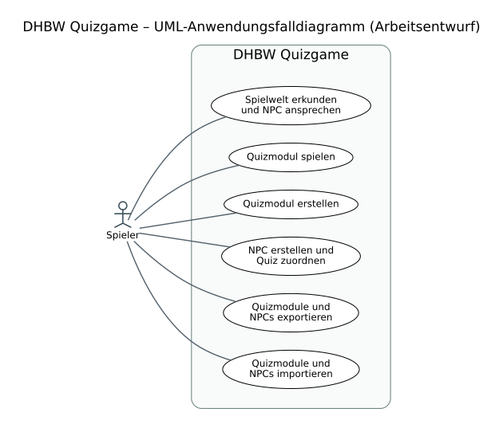

# Softwareanforderungsspezifikation (SRS) – DHBW Quizgame

| Dokumentinformation | Wert |
|---|---|
| Projekt | DHBW Quizgame – Quizbasiertes Lernspiel mit begehbarer Spielwelt |
| Lehrveranstaltung | Grundlagen des Software Engineering, DHBW Karlsruhe |
| Schwerpunkt | **Kapitel 2: Funktionale Anforderungen** gemäß Vorlesung Harald Ichters, *Funktionale Anforderungsanalyse*, 13.10.2026 |
| Status | Nicht vom Projektteam freigegebene Anforderungs-Baseline; Abstimmung offen |

## 1. Einleitung

### 1.1 Übersicht

**DHBW Quizgame** ist ein geplantes, lokal nutzbares Lernspiel, das thematische Quizmodule mit der Erkundung einer 2D-Spielwelt verbindet. Die Spielerfigur bewegt sich zu NPCs, über die Quizmodule ausgewählt und bearbeitet werden. Ein Benutzer kann zudem eigene Quizmodule und NPCs erstellen und über Dateien austauschen. Die spielerische Darstellung orientiert sich an Retro-RPGs; das vorhandene Menü-/NPC-Design ist in Figma dokumentiert.

**Stakeholder:** Spieler/Lernende, Benutzer mit der Rolle „Quiz-Ersteller“, das Projektteam und der betreuende Lehrende. „Quiz-Ersteller“ bezeichnet eine Nutzungsrolle, **kein** bestätigtes getrenntes Benutzerkonto.

### 1.2 Geltungsbereich

**Teil des geplanten Funktionsumfangs:** 2D-Spielwelt und NPC-Interaktion, Auswahl und Bearbeitung thematischer Quizmodule, Fragetypen Multiple Choice/Freitext/Zahl, optionales Bild und Hinweise, Punkte, Modul-/NPC-Erstellung, lokal gespeicherte Inhalte, Import und Export, mehrere Demonstrationsmodule.

**Nicht verbindlich für die erste Version:** Cloud-Hosting, PostgreSQL-Deployment, Online-Mehrspielerbetrieb und Online-Synchronisierung. Visuell gezeigte Sterne, Quests, Einstellungen oder automatische Fortschrittsspeicherung sind noch als Vorschläge zu bestätigen.

### 1.3 Definitionen, Akronyme und Abkürzungen

| Begriff | Erläuterung |
|---|---|
| SRS | Software Requirements Specification; Softwareanforderungsspezifikation |
| UML | Unified Modeling Language |
| Use Case / Anwendungsfall | Aus Sicht eines Akteurs sinnvolle Interaktion mit dem System zur Erreichung eines Ziels |
| GUI | Graphical User Interface, grafische Benutzeroberfläche |
| NPC | Non-Player Character / Nichtspielercharakter |
| Quizmodul | Thematisch zusammengehörige Quizfragen, optional mit Bildern/Hinweisen/Zwischentexten |
| Quiz-Ersteller | Rolle des Benutzers beim Anlegen und Teilen von Inhalten |
| SQLite | Lokale relationale Datenbank des Erstsystems |
| FA | Identifikator einer funktionalen Einzelanforderung |
| UC | Identifikator eines Anwendungsfalls |

### 1.4 Referenzen

1. **Vorlesung:** Harald Ichters, *Funktionale Anforderungsanalyse – UML Verhaltensdiagramme*, DHBW Karlsruhe, 13.10.2026, insbesondere Folien 12–16, 21–24.
2. **Jira-User-Stories:** [SCRUM-6](https://softwareengineeringsite.atlassian.net/browse/SCRUM-6), [SCRUM-7](https://softwareengineeringsite.atlassian.net/browse/SCRUM-7), [SCRUM-8](https://softwareengineeringsite.atlassian.net/browse/SCRUM-8), [SCRUM-9](https://softwareengineeringsite.atlassian.net/browse/SCRUM-9), [SCRUM-10](https://softwareengineeringsite.atlassian.net/browse/SCRUM-10).
3. **Verbindliche Designreferenz:** [Original: Menü-Mockup in Figma](https://www.figma.com/design/YkwCZacuoRePduhsts6pTt/Men%C3%BC-Mockup?node-id=0-1&t=jgPMQzG9T4ny4CIw-1). Die unveränderte Originaldatei ist zu verwenden; die Zugriffskopie diente nur zur Einsicht.
4. **Projektidee:** [GitHub Discussion #1](https://github.com/Styximus/Software-Engineering/discussions/1) (Volltext noch nicht geprüft).
5. **Kursvorlage:** Moodle `SoftwareAnforderungsspezifikation.md` (Datei noch nicht bereitgestellt; exakte Layout-Übereinstimmung daher noch offen).

## 2. Funktionale Anforderungen

### 2.1 Gesamtübersicht und Anwendungsfalldiagramm

**Akteur:** *Spieler* (derselbe Benutzer handelt beim Erstellen und Austauschen von Inhalten in der Rolle eines *Quiz-Erstellers*; es ist bislang **keine** getrennte Rechteverwaltung spezifiziert). Das folgende Diagramm zeigt sechs zentrale, von außen beobachtbare Anwendungsfälle. Sie fassen die detaillierten Anforderungen FA-001 bis FA-030 zusammen.

**Editierbare Quelle:** [PlantUML-Datei](uml/anwendungsfalldiagramm_v2.puml). Das Use-Case-Diagramm ist ein Arbeitsentwurf und vor Abgabe mit dem Team abzustimmen.

**UI-Mockup:** [Figma – Original-Menü-Mockup](https://www.figma.com/design/YkwCZacuoRePduhsts6pTt/Men%C3%BC-Mockup?node-id=0-1&t=jgPMQzG9T4ny4CIw-1). Bisher wurden die Frames „Startmenü · Wissensinsel“ und „NPC-Dialog · Milas Naturquiz“ anhand einer zugänglichen *Kopie* geprüft. Die Kopie ist keine alternative Designvorgabe. Die Quiz-/Editor-/Importansichten konnten damit nicht nachgewiesen werden.

**User Stories:** Die [Jira-Tickets SCRUM-6 bis SCRUM-10](https://softwareengineeringsite.atlassian.net/browse/SCRUM-6) sind die Hauptquellen der Use Cases. Die Einzelzuordnung steht in Abschnitt 2.4.

### 2.2 Tabellarische Beschreibungen der Anwendungsfälle

Die Tabellen folgen den in der Vorlesung behandelten Merkmalen: Name, Akteur, Annahmen, Vor- und Nachbedingungen, Ausnahmen, offene Punkte sowie Daten, Auslöser und Systemantwort (Folien 22 und 24). **Unentschiedene Details sind nicht als verbindlich angenommen.**

#### 2.2.1 Spielwelt erkunden und NPC ansprechen

| Merkmal | Beschreibung |
|---|---|
| Name | **UC-01 – Spielwelt erkunden und NPC ansprechen** |
| Akteur | Spieler |
| Beschreibung / Ziel | Der Spieler bewegt seine Spielfigur durch eine Karte und öffnet die Unterhaltung mit einem erreichbaren NPC. |
| Annahmen | Die Anwendung verfügt über eine initiale Spielkarte mit mindestens einem NPC. |
| Vorbedingungen | Die Spielwelt ist geöffnet; Spielerfigur und NPC sind sichtbar. |
| Auslöser | Der Spieler steuert seine Figur und betätigt in der Nähe eines NPC die Interaktionstaste. |
| Hauptablauf | 1. Das System zeigt die Karte und die Spielfigur. 2. Der Spieler bewegt sich zu einem NPC. 3. Der Spieler löst die Interaktion aus. 4. Das System öffnet den entsprechenden NPC-Dialog. |
| Nachbedingungen | Der NPC-Dialog ist sichtbar; die Spielfigur bleibt in der Spielwelt erhalten. |
| Ausnahmen | Befindet sich kein NPC in Interaktionsreichweite, wird kein fremder Dialog geöffnet. |
| Daten | Spielerposition, NPC-Konfiguration, Tastatureingabe. |
| Antwort des Systems | Ein geöffnetes Dialogfenster mit Informationen zum NPC und ggf. einem Quizangebot. |
| Zukünftige Verbesserungen | Zusätzliche Gebiete oder alternative Eingabegeräte sind denkbar, aber nicht beschlossen. |
| Offene Punkte | Steuerungskonflikt: SCRUM-6 fordert Pfeiltasten/Leertaste; Figma zeigt WASD/E. Reichweite und Kollisionsregeln noch nicht definiert. |
| Jira / Anforderungen | [SCRUM-6](https://softwareengineeringsite.atlassian.net/browse/SCRUM-6); FA-001 bis FA-004 |

#### 2.2.2 Quizmodul spielen

| Merkmal | Beschreibung |
|---|---|
| Name | **UC-02 – Quizmodul spielen** |
| Akteur | Spieler |
| Beschreibung / Ziel | Der Spieler wählt beim NPC ein Quizmodul aus und beantwortet die enthaltenen Fragen. |
| Annahmen | Mindestens ein spielbares Modul ist vorhanden und einem NPC zugeordnet. |
| Vorbedingungen | Das Modul steht über den NPC-Dialog bzw. das Modulmenü zur Auswahl. |
| Auslöser | Der Spieler betätigt „Quiz starten“ beziehungsweise die entsprechende Auswahlaktion. |
| Hauptablauf | 1. Das System öffnet die Quizansicht. 2. Das System zeigt eine Frage mit dem zugehörigen Antwortformat. 3. Der Spieler gibt eine Antwort ein und setzt das Quiz fort. 4. Das System verarbeitet die Antwort entsprechend dem konfigurierten Fragetyp. 5. Nach der Bearbeitung kann der Spieler zum Modulmenü zurückkehren. |
| Nachbedingungen | Die Antworten werden verarbeitet; der Spieler kann die Quizansicht wieder verlassen. Eine Ergebnisansicht ist noch als Teamvorschlag gekennzeichnet. |
| Ausnahmen | Ein unvollständiges oder fehlerhaftes Modul darf nicht unbemerkt als vollständiges Quiz dargestellt werden. Verhalten beim Abbruch ist offen. |
| Daten | Quizfragen, Antwortoptionen, Bilder, Hinweise, Eingaben und Punktwerte. |
| Antwort des Systems | Eine zur Frage passende Quizansicht und die Verarbeitung der Antworten. |
| Zukünftige Verbesserungen | Ergebnisübersicht und persistente Statistik sind mögliche Erweiterungen; nur die Ergebnisübersicht ist bereits als Teamvorschlag formuliert. |
| Offene Punkte | Auswertungsregeln für Mehrfachauswahl, Freitext, Zahlen, Teilpunkte und Hinweise sowie Verhalten bei Abbruch entscheiden. |
| Jira / Anforderungen | [SCRUM-6](https://softwareengineeringsite.atlassian.net/browse/SCRUM-6), [SCRUM-7](https://softwareengineeringsite.atlassian.net/browse/SCRUM-7), [SCRUM-8](https://softwareengineeringsite.atlassian.net/browse/SCRUM-8); FA-006 bis FA-015 |

#### 2.2.3 Quizmodul erstellen

| Merkmal | Beschreibung |
|---|---|
| Name | **UC-03 – Quizmodul erstellen** |
| Akteur | Quiz-Ersteller (Spieler in der Erstellerrolle) |
| Beschreibung / Ziel | Der Benutzer legt ein thematisches Quizmodul mit Fragen aus vordefinierten Vorlagen an. |
| Annahmen | Ein grafischer Quiz-Editor und lokale Datenhaltung sind vorgesehen. |
| Vorbedingungen | Der Benutzer hat den Editor geöffnet (laut SCRUM-9 über einen Customizer-NPC). |
| Auslöser | Der Benutzer wählt „Modul erstellen“ oder eine entsprechende Editorfunktion. |
| Hauptablauf | 1. Ein Modul mit Thema/Kategorie wird angelegt. 2. Der Benutzer fügt passende Fragen und optionale Bilder, Hinweise sowie Zwischentexte hinzu. 3. Er legt Punkte und ggf. Zufallsreihenfolge fest. 4. Er speichert das Modul. |
| Nachbedingungen | Ein gespeichertes Quizmodul ist nach erneutem Öffnen zur Auswahl verfügbar. |
| Ausnahmen | Ungültige oder unvollständige Eingaben müssen vor dem Speichern behandelt werden; Art der Validierung ist noch nicht vereinbart. |
| Daten | Kategorie, Fragen, richtige Antworten, optionale Medien, Hinweise, Punktwerte und Zufallsoption. |
| Antwort des Systems | Ein gespeichertes und später ausführbares Quizmodul. |
| Zukünftige Verbesserungen | Spätere Online-Verwaltung von Modulen ist nicht Bestandteil der Erstversion. |
| Offene Punkte | Pflichtfelder, Detailregeln für Antworten, Dateiformate und Validierung abstimmen. |
| Jira / Anforderungen | [SCRUM-7](https://softwareengineeringsite.atlassian.net/browse/SCRUM-7), [SCRUM-9](https://softwareengineeringsite.atlassian.net/browse/SCRUM-9); FA-005, FA-016 bis FA-020, FA-028 |

#### 2.2.4 NPC erstellen und Quiz zuordnen

| Merkmal | Beschreibung |
|---|---|
| Name | **UC-04 – NPC erstellen und Quiz zuordnen** |
| Akteur | Quiz-Ersteller (Spieler in der Erstellerrolle) |
| Beschreibung / Ziel | Der Benutzer erstellt einen NPC mit PNG-Grafik und ordnet ihm ein selbst erstelltes Quiz zu. |
| Annahmen | Eine Erstellungsoberfläche und ein vorhandenes oder neu angelegtes Quizmodul sind verfügbar. |
| Vorbedingungen | Der Customizer-NPC bzw. eine entsprechende Bearbeitungsansicht ist geöffnet. |
| Auslöser | Der Benutzer startet das Anlegen eines NPC. |
| Hauptablauf | 1. Das System zeigt die NPC-Erstellungsoberfläche. 2. Der Benutzer wählt oder lädt eine PNG-Grafik. 3. Er ordnet dem NPC ein Quizmodul zu. 4. Er speichert den NPC. |
| Nachbedingungen | Der NPC ist gespeichert und sein zugeordnetes Quiz kann über ihn gestartet werden. |
| Ausnahmen | Fehlerhaftes PNG oder ungültige Modulreferenz: Das System darf keinen unbrauchbaren vollständigen NPC-Datensatz erzeugen; konkretes Fehlerverhalten noch festzulegen. |
| Daten | PNG-Grafik, NPC-Daten, Referenz auf das Quizmodul. |
| Antwort des Systems | Ein verfügbarer, ansprechbarer NPC mit zugeordnetem Quiz. |
| Zukünftige Verbesserungen | NPC-Animationen oder komplexe Dialogbäume sind nicht vereinbart. |
| Offene Punkte | Platzierung in der Spielwelt, erlaubte Bildgrößen und Anzahl der Module pro NPC klären. |
| Jira / Anforderungen | [SCRUM-7](https://softwareengineeringsite.atlassian.net/browse/SCRUM-7), [SCRUM-9](https://softwareengineeringsite.atlassian.net/browse/SCRUM-9); FA-020 bis FA-023 |

#### 2.2.5 Quizmodule und NPCs exportieren

| Merkmal | Beschreibung |
|---|---|
| Name | **UC-05 – Quizmodule und NPCs exportieren** |
| Akteur | Quiz-Ersteller (Spieler in der Erstellerrolle) |
| Beschreibung / Ziel | Der Benutzer exportiert ein eigenes Quizmodul oder einen NPC in eine Datei zur Weitergabe. |
| Annahmen | Das zu exportierende Element ist lokal vorhanden und gespeichert. |
| Vorbedingungen | Der Benutzer öffnet die Exportfunktion für ein ausgewähltes Element. |
| Auslöser | Der Benutzer wählt den Export eines Moduls oder NPC. |
| Hauptablauf | 1. Das System bestimmt die zu exportierenden Daten. 2. Es erzeugt eine Datei oder ein Paket. 3. Es stellt das Exportergebnis zur Weitergabe bereit. |
| Nachbedingungen | Ein exportiertes Element kann grundsätzlich durch die vorgesehene Importfunktion wieder eingelesen werden. |
| Ausnahmen | Fehler beim Dateizugriff oder unvollständige Inhalte werden nicht als erfolgreicher Export gemeldet. |
| Daten | Modul- oder NPC-Daten, zugehörige Bilder und Konfiguration. |
| Antwort des Systems | Ein exportierbares Dateiartefakt. |
| Zukünftige Verbesserungen | Cloud-Synchronisation ist nicht Bestandteil der Erstversion. |
| Offene Punkte | Dateiformat, Versionierung, Pfade und Behandlung referenzierter Medien festlegen. |
| Jira / Anforderungen | [SCRUM-10](https://softwareengineeringsite.atlassian.net/browse/SCRUM-10); FA-024, FA-026 |

#### 2.2.6 Quizmodule und NPCs importieren

| Merkmal | Beschreibung |
|---|---|
| Name | **UC-06 – Quizmodule und NPCs importieren** |
| Akteur | Quiz-Ersteller (Spieler in der Erstellerrolle) |
| Beschreibung / Ziel | Der Benutzer übernimmt eine von einem anderen Benutzer erhaltene Exportdatei in den lokalen Datenbestand. |
| Annahmen | Die Anwendung verfügt über eine Importfunktion und einen beschreibbaren lokalen Datenspeicher. |
| Vorbedingungen | Eine vom System unterstützte Datei liegt vor. |
| Auslöser | Der Benutzer wählt eine Datei zur Übernahme. |
| Hauptablauf | 1. Das System liest die Datei. 2. Es prüft die enthaltenen Daten. 3. Es übernimmt einen gültigen Quiz- bzw. NPC-Datensatz in die lokale Datenhaltung. 4. Es macht ihn in der Modulauswahl beziehungsweise bei den NPCs verfügbar. |
| Nachbedingungen | Ein gültig importiertes Objekt ist anschließend nutzbar. |
| Ausnahmen | Bei ungültigen Formaten, fehlenden Medien oder Datenkonflikten wird kein unbemerkter Teilimport als Erfolg ausgegeben; konkrete Konfliktstrategie ist offen. |
| Daten | Datei mit Modul- oder NPC-Konfiguration und zugehörigen Medien. |
| Antwort des Systems | Ein lokal verfügbares importiertes Modul oder ein importierter NPC. |
| Zukünftige Verbesserungen | Direkter Online-Austausch ist nicht vorgesehen. |
| Offene Punkte | Dateiformat, Umgang mit Namens-/ID-Konflikten und NPC-Platzierung klären. |
| Jira / Anforderungen | [SCRUM-10](https://softwareengineeringsite.atlassian.net/browse/SCRUM-10); FA-025, FA-027, FA-030 |

### 2.3 Funktionale Einzelanforderungen (prüfbare Detaillierung)

Die folgenden FA-Nummern ergänzen die Use Cases durch konkrete, einzeln überprüfbare Aussagen. **MUSS** bezeichnet den derzeit in Jira beziehungsweise der Projektbeschreibung dokumentierten Zielumfang, nicht bereits implementierte Software. **TEAMVORSCHLAG** bezeichnet eine noch abzustimmende Ergänzung. Akzeptanztests sind Entwürfe; sie prüfen Anforderungsverhalten, nicht die tatsächliche Umsetzung.

#### 2.3.1 Spielwelt und Navigation

| ID | Priorität | Anforderung | Akzeptanztest | Referenz |
|---|---|---|---|---|
| **FA-001** | MUSS | Die Anwendung zeigt eine begehbare 2D-Spielwelt mit einer Spielerfigur und mindestens einem NPC. | Nach dem Start der Spielwelt sind die Spielerfigur und ein NPC sichtbar. | [SCRUM-6](https://softwareengineeringsite.atlassian.net/browse/SCRUM-6) |
| **FA-002** | MUSS | Der Spieler kann die Figur über eine Tastatureingabe in der Spielwelt bewegen. Die konkrete Tastenbelegung ist noch festzulegen (Jira: Pfeiltasten; Figma: WASD). | Eine Bewegungseingabe in eine begehbare Richtung verändert die sichtbare Position. | [SCRUM-6](https://softwareengineeringsite.atlassian.net/browse/SCRUM-6) |
| **FA-003** | MUSS | Der Spieler kann mit einem erreichbaren NPC über eine Interaktionstaste sprechen. Die konkrete Tastenbelegung ist noch festzulegen (Jira: Leertaste; Figma: E). | Beim erreichbaren NPC öffnet sich die NPC-Interaktionsansicht; andernfalls nicht. | [SCRUM-6](https://softwareengineeringsite.atlassian.net/browse/SCRUM-6) |
| **FA-004** | MUSS | Ein Quiz-NPC zeigt die ihm zugeordneten Quizmodule in einem Auswahlmenü an und erlaubt deren Start. | Ein Modul wird nach NPC-Interaktion angezeigt und lässt sich starten. | [SCRUM-6](https://softwareengineeringsite.atlassian.net/browse/SCRUM-6), [SCRUM-7](https://softwareengineeringsite.atlassian.net/browse/SCRUM-7) |
| **FA-005** | MUSS | Ein Quizmodul wird einer thematischen Kategorie zugeordnet. | Die Kategorie eines gespeicherten Moduls ist in der Übersicht sichtbar. | Projektbeschreibung |
#### 2.3.2 Quizdurchführung

| ID | Priorität | Anforderung | Akzeptanztest | Referenz |
|---|---|---|---|---|
| **FA-006** | MUSS | Das System stellt Fragen und Antworten unterschiedlicher Typen einheitlich, geordnet und verständlich in einer Quizansicht dar. | Ein gestartetes Modul zeigt alle unterstützten Frageformate ohne Layoutverlust. | [SCRUM-8](https://softwareengineeringsite.atlassian.net/browse/SCRUM-8) |
| **FA-007** | MUSS | Die Quizansicht lässt sich über das Modulmenü erreichen; eine Rückkehr zum Modulmenü ist möglich. | Vom Modulmenü aus kann ein Quiz geöffnet werden; aus der Quizansicht ist die Rücknavigation möglich. | [SCRUM-8](https://softwareengineeringsite.atlassian.net/browse/SCRUM-8) |
| **FA-008** | MUSS | Das System unterstützt Multiple-Choice-Fragen einschließlich mehrerer richtiger Antwortoptionen. | Eine Frage mit mehreren richtigen Optionen kann angezeigt und beantwortet werden. | [SCRUM-7](https://softwareengineeringsite.atlassian.net/browse/SCRUM-7) |
| **FA-009** | MUSS | Das System unterstützt Fragen mit frei eingegebener Textantwort. | Eine Textfrage nimmt eine Zeichenfolge als Antwort entgegen. | [SCRUM-7](https://softwareengineeringsite.atlassian.net/browse/SCRUM-7) |
| **FA-010** | MUSS | Das System unterstützt Fragen mit numerischen Antworten. | Eine Zahlenfrage kann mit einer Zahl beantwortet werden; eine ungültige Eingabe wird nicht als richtige Zahl gewertet. | [SCRUM-7](https://softwareengineeringsite.atlassian.net/browse/SCRUM-7) |
| **FA-011** | MUSS | Fragen können ein zugeordnetes Bild anzeigen. | Eine Frage mit vorhandenem Bild zeigt dieses in der Quizansicht an. | [SCRUM-7](https://softwareengineeringsite.atlassian.net/browse/SCRUM-7) |
| **FA-012** | MUSS | Zu einer Frage kann ein optionaler Hinweis eingeblendet werden. | Ein gespeicherter Hinweis kann während dieser Frage aufgerufen werden. | [SCRUM-7](https://softwareengineeringsite.atlassian.net/browse/SCRUM-7) |
| **FA-013** | MUSS | Quizmodule können Textelemente zwischen Fragen enthalten. | Ein Zwischentext wird an der konfigurierten Stelle in der Fragenfolge angezeigt. | [SCRUM-7](https://softwareengineeringsite.atlassian.net/browse/SCRUM-7) |
| **FA-014** | MUSS | Fragen können mit einem Punktwert versehen und anhand der Antworten bewertet werden. | Bei einer vollständig richtigen Antwort wird der konfigurierte Punktwert vergeben. | [SCRUM-7](https://softwareengineeringsite.atlassian.net/browse/SCRUM-7) |
| **FA-015** | TEAMVORSCHLAG | Nach Abschluss eines Quiz zeigt das System die erreichten Punkte an. | Nach der letzten Frage erscheint eine Ergebnisansicht mit der Gesamtpunktzahl. | [SCRUM-7](https://softwareengineeringsite.atlassian.net/browse/SCRUM-7), [SCRUM-8 (abgeleitet)](https://softwareengineeringsite.atlassian.net/browse/SCRUM-8) |
#### 2.3.3 Erstellung von Quizmodulen und NPCs

| ID | Priorität | Anforderung | Akzeptanztest | Referenz |
|---|---|---|---|---|
| **FA-016** | MUSS | Der Benutzer kann über eine grafische Oberfläche Quizmodule aus vordefinierten Vorlagen erstellen. | Ein eigenes Modul mit mindestens einer Frage kann gespeichert und später ausgewählt werden. | [SCRUM-7](https://softwareengineeringsite.atlassian.net/browse/SCRUM-7) |
| **FA-017** | MUSS | Der Quiz-Editor kann die Fragetypen, Bilder, Hinweise und Zwischentexte gemäß FA-008 bis FA-013 konfigurieren. | Alle aufgeführten Elemente lassen sich im Editor anlegen und anschließend im Quiz abspielen. | [SCRUM-7](https://softwareengineeringsite.atlassian.net/browse/SCRUM-7) |
| **FA-018** | MUSS | Der Quiz-Editor ermöglicht die Vergabe einer Punktzahl pro Frage. | Ein gespeicherter Punktwert ist nach erneutem Laden unverändert. | [SCRUM-7](https://softwareengineeringsite.atlassian.net/browse/SCRUM-7) |
| **FA-019** | MUSS | Der Ersteller kann die zufällige Reihenfolge der Fragen für ein Modul aktivieren oder deaktivieren. | Bei deaktiviertem Zufall bleibt die Reihenfolge erhalten; bei aktiviertem Zufall kann sie variieren. | [SCRUM-7](https://softwareengineeringsite.atlassian.net/browse/SCRUM-7) |
| **FA-020** | MUSS | Der Ersteller kann einem Quizmodul einen NPC zuordnen. | Ein zugeordnetes Modul erscheint im Auswahlmenü des betreffenden NPCs. | [SCRUM-7](https://softwareengineeringsite.atlassian.net/browse/SCRUM-7) |
| **FA-021** | MUSS | Ein spezieller Customizer-NPC ermöglicht das Öffnen der Oberfläche zur Erstellung von NPCs und Quizmodulen. | Die Interaktion mit dem Customizer-NPC öffnet die Erstellungsoberfläche. | [SCRUM-9](https://softwareengineeringsite.atlassian.net/browse/SCRUM-9) |
| **FA-022** | MUSS | Der Benutzer kann einen NPC anlegen und ihm eine eigene PNG-Grafik zuweisen. | Ein NPC mit gültigem PNG kann gespeichert und mit dieser Grafik dargestellt werden. | [SCRUM-9](https://softwareengineeringsite.atlassian.net/browse/SCRUM-9) |
| **FA-023** | MUSS | Ein neu erstellter NPC kann vom Benutzer erstellte Quizmodule anbieten. | Ein neu angelegtes Quiz kann beim neu angelegten NPC gestartet werden. | [SCRUM-9](https://softwareengineeringsite.atlassian.net/browse/SCRUM-9) |
#### 2.3.4 Import und Export

| ID | Priorität | Anforderung | Akzeptanztest | Referenz |
|---|---|---|---|---|
| **FA-024** | MUSS | Der Benutzer kann gespeicherte Quizmodule in eine Datei exportieren. | Eine exportierte Datei enthält die zur Wiederherstellung erforderlichen Quizdaten. | [SCRUM-10](https://softwareengineeringsite.atlassian.net/browse/SCRUM-10) |
| **FA-025** | MUSS | Der Benutzer kann eine gültige exportierte Quizdatei importieren. | Ein importiertes Modul erscheint in der Übersicht und ist spielbar. | [SCRUM-10](https://softwareengineeringsite.atlassian.net/browse/SCRUM-10) |
| **FA-026** | MUSS | Der Benutzer kann NPCs mit ihrer erforderlichen Konfiguration und ihren Bilddaten exportieren. | Eine exportierte Datei bzw. ein Dateipaket ermöglicht die Wiederherstellung des NPCs. | [SCRUM-10](https://softwareengineeringsite.atlassian.net/browse/SCRUM-10) |
| **FA-027** | MUSS | Der Benutzer kann einen gültigen exportierten NPC importieren und der Spielwelt verfügbar machen. | Der importierte NPC erscheint in der vorgesehenen Übersicht bzw. Spielwelt. | [SCRUM-10](https://softwareengineeringsite.atlassian.net/browse/SCRUM-10) |
#### 2.3.5 Datenhaltung und Demoinhalte

| ID | Priorität | Anforderung | Akzeptanztest | Referenz |
|---|---|---|---|---|
| **FA-028** | MUSS | Die Desktop-Anwendung speichert Module, Fragen, Kategorien, NPCs und deren Zuordnungen lokal in SQLite. | Nach einem Neustart stehen vorher gespeicherte Inhalte wieder zur Verfügung. | Projektbeschreibung, [SCRUM-7](https://softwareengineeringsite.atlassian.net/browse/SCRUM-7), [SCRUM-9](https://softwareengineeringsite.atlassian.net/browse/SCRUM-9) |
| **FA-029** | MUSS | Die Anwendung stellt mehrere vorprogrammierte Demo-Module zu unterschiedlichen Themen bereit. | In einer frischen Demo-Installation sind mindestens zwei verschiedene Module auswählbar. | Projektbeschreibung |
| **FA-030** | TEAMVORSCHLAG | Bei ungültigen oder unvollständigen Eingaben sowie Importdateien zeigt das System eine verständliche Fehlermeldung und schützt vorhandene Daten. | Der Import einer ungültigen Datei erzeugt eine Fehlermeldung und keinen teilweise gespeicherten Datensatz. | [SCRUM-7](https://softwareengineeringsite.atlassian.net/browse/SCRUM-7), [SCRUM-10 (abgeleitet)](https://softwareengineeringsite.atlassian.net/browse/SCRUM-10) |

### 2.4 Rückverfolgbarkeit: User Stories, Use Cases und Anforderungen

| User Story | Use Case | Einzelanforderungen | GUI-Bezug |
|---|---|---|---|
| [SCRUM-6](https://softwareengineeringsite.atlassian.net/browse/SCRUM-6) | UC-01, UC-02 | FA-001 bis FA-004 | Startmenü und NPC-Dialog in Figma |
| [SCRUM-7](https://softwareengineeringsite.atlassian.net/browse/SCRUM-7) | UC-02, UC-03, UC-04 | FA-005, FA-008 bis FA-020 | Quiz-/Editor-Frames noch nicht nachgewiesen |
| [SCRUM-8](https://softwareengineeringsite.atlassian.net/browse/SCRUM-8) | UC-02 | FA-006, FA-007, FA-015 (Vorschlag) | NPC-Dialog zeigt Quiz-Einstieg, keine eigentliche Quizansicht |
| [SCRUM-9](https://softwareengineeringsite.atlassian.net/browse/SCRUM-9) | UC-03, UC-04 | FA-020 bis FA-023 | Customizer-Frame noch nicht nachgewiesen |
| [SCRUM-10](https://softwareengineeringsite.atlassian.net/browse/SCRUM-10) | UC-05, UC-06 | FA-024 bis FA-027 | Import-/Export-Frame noch nicht nachgewiesen |
| Projektbeschreibung | UC-02, UC-03 | FA-005, FA-028, FA-029 | Mehrere Demo-Module / lokale Speicherung |

### 2.5 GUI-Mockup und erkannte Unterschiede

**Maßgebliche Designquelle:** [Original-Figma](https://www.figma.com/design/YkwCZacuoRePduhsts6pTt/Men%C3%BC-Mockup?node-id=0-1&t=jgPMQzG9T4ny4CIw-1). Das Design wurde **nicht** bearbeitet. Die zugängliche Kopie diente allein zur Sichtprüfung der zwei folgenden Frames.

| Eingesehener Figma-Frame | Sichtbarer Inhalt | Use Cases |
|---|---|---|
| **Startmenü · Wissensinsel** | Inselkarte, Spielerfigur, thematische NPCs, „Abenteuer beginnen“, „So wird gespielt“, Einstellungen, Fortschritt/Sterne und Steuerungsleiste | UC-01 (Spielwelt), UC-02 (Einstieg) |
| **NPC-Dialog · Milas Naturquiz** | NPC-Porträt und Dialog, Quizname, Umfang, Dauer, Schwierigkeit, Sternbelohnung, „Quiz starten“, „Vielleicht später“ | UC-01 (NPC-Interaktion), UC-02 (Quizstart) |

**Zu klärender Widerspruch:** [SCRUM-6](https://softwareengineeringsite.atlassian.net/browse/SCRUM-6) nennt **Pfeiltasten** und **Leertaste**. Beide geprüften Figma-Frames zeigen **WASD**, **E** und **Esc**. FA-002 und FA-003 spezifizieren daher die Bewegungs-/Interaktionsfunktion ohne eine abschließend festgelegte Tastenbelegung. Die konkrete Wahl muss das Projektteam entscheiden und anschließend Jira, SRS und Implementierung konsistent halten.

### 2.6 Weitere Funktionskandidaten

Die nachfolgenden Funktionen sind im Mockup sichtbar oder dort angekündigt, jedoch durch SCRUM-6 bis SCRUM-10 **nicht vollständig als User Stories bestätigt**. Deshalb tragen sie ausdrücklich den Status **TEAMVORSCHLAG** und erweitern die verbindliche Erstversion noch nicht.

| ID | Status | Anforderungskandidat | Vorgeschlagener Akzeptanztest | UI-Bezug |
|---|---|---|---|---|
| **FA-031** | TEAMVORSCHLAG | Ein Startmenü ermöglicht das Betreten der Spielwelt über „Abenteuer beginnen“. | Nach Auswahl dieser Aktion wird die Spielwelt geöffnet. | Startmenü |
| **FA-032** | TEAMVORSCHLAG | Die Aktion „So wird gespielt“ zeigt eine Bedien- bzw. Spielanleitung an. | Die Aktion öffnet einen lesbaren Hilfetext, der sich schließen lässt. | Startmenü |
| **FA-033** | TEAMVORSCHLAG | Über „Einstellungen“ kann der Benutzer eine Einstellungsansicht öffnen. | Die Einstellungsansicht wird geöffnet und kann wieder geschlossen werden; einstellbare Parameter sind noch festzulegen. | Startmenü |
| **FA-034** | TEAMVORSCHLAG | Der Benutzer kann die Tonausgabe über die sichtbare Tonsteuerung aktivieren oder deaktivieren. | Nach Aktivierung bzw. Deaktivierung wird die zugehörige Tonausgabe entsprechend umgeschaltet. | Startmenü und Spielstatus |
| **FA-035** | TEAMVORSCHLAG | Das System zeigt den Fortschritt anhand gesammelter Sterne und einer Spielerbezeichnung/Stufe an. | Nach einer definierten Sternvergabe ist der angezeigte Fortschrittswert konsistent aktualisiert; Vergabe- und Stufenregeln bleiben offen. | Kopfbereich beider Ansichten |
| **FA-036** | TEAMVORSCHLAG | Die Spieloberfläche zeigt aktuelle Aufgaben und erledigte Teilziele mit Fortschrittsindikator an. | Nach Erfüllung eines definierten Teilziels wird dessen Status aktualisiert. | NPC-Dialog / Abenteuerziel |
| **FA-037** | TEAMVORSCHLAG | Der angezeigte Spielfortschritt wird automatisch gespeichert. | Nach Erreichen eines eindeutig definierten Fortschrittsereignisses und Neustart ist dieser Zustand wiederhergestellt; genaue Speicherauslöser bleiben offen. | Hinweis im Startmenü |
| **FA-038** | TEAMVORSCHLAG | Ein NPC-Dialog zeigt Informationen zum angebotenen Quiz (Thema, Frageanzahl, Dauer, Schwierigkeit, mögliche Sterne) und ermöglicht Start, Verschieben oder Schließen. | Die gespeicherten Metadaten erscheinen im Dialog; „Quiz starten“ öffnet das Quiz, „Vielleicht später“ und Schließen verlassen den Dialog ohne Quizstart. | NPC-Dialog · Milas Naturquiz |

## 3. Nichtfunktionale Anforderungen

Dieser Abschnitt wird zu einem späteren Zeitpunkt gemäß Kursvorgabe konkretisiert. Für eine abnahmefähige Fassung wären etwa messbare Anforderungen an Bedienbarkeit, Reaktionszeiten, Datenintegrität, Betriebssystemunterstützung und Barrierefreiheit erforderlich. **Derzeit sind dafür keine von der Projektgruppe bestätigten Grenzwerte verfügbar.**

## 4. Technische Einschränkungen

| Kennung | Einschränkung / Rahmenbedingung | Stand |
|---|---|---|
| TE-01 | Implementierung in **Java** | Projektbeschreibung; zu bestätigen |
| TE-02 | Desktop-GUI mit **Swing** | Projektbeschreibung; zu bestätigen |
| TE-03 | Lokale Persistenz mittels **SQLite** | Projektbeschreibung; zu bestätigen |
| TE-04 | Dateien zum Import und Export von Quizmodulen und NPCs; **Datenformat noch nicht festgelegt** | SCRUM-10 |
| TE-05 | **PNG** als Grafikformat für selbst erstellte NPCs | SCRUM-9 |
| TE-06 | **PostgreSQL** ist nur für eine mögliche spätere Cloud-Version angedacht und keine verbindliche Erstversionsanforderung | Projektbeschreibung |

---

## Anhang A: Offene Punkte für die Teamabstimmung

1. **Moodle-Vorlage und GitHub-Diskussion:** Beide Quellen vollständig prüfen und bei abweichendem Inhalt anpassen.
2. **Steuerung:** Pfeiltasten/Leertaste versus WASD/E/Esc entscheiden (SCRUM-6 und Figma).
3. **Fragenbewertung:** Mehrfachantworten, Textnormalisierung, numerische Toleranz, Punkte und ggf. Teilpunkte definieren.
4. **Quiz-Navigation:** Abbruch, Zurück, Wiederaufnahme und Ergebnisanzeige festlegen.
5. **Erstellung:** Pflichtfelder, PNG-Grenzen, Zahl der Module je NPC, Platzierung neuer NPCs und Kollisionslogik abstimmen.
6. **Dateiaustausch:** Dateiformat, Referenzen/Bildbeilage, Version und Konflikte beim Import beschließen.
7. **UI-Funktionskandidaten:** FA-031 bis FA-038 einzeln priorisieren und bei Zustimmung in Jira übernehmen.
8. **Mockup-Abdeckung:** Für Quizansicht, Ersteller und Datenaustausch existierende Figma-Frames prüfen; keine neuen Designs ohne Teamentscheidung annehmen.
