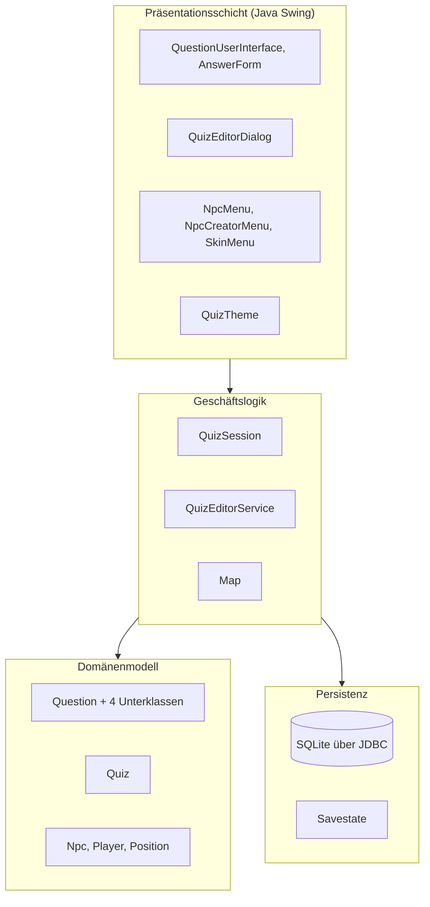

# Architekturentscheidungen und Designprinzipien – QuizMaster

Stand: 24.11.2026 · Grundlage: [Qualitätsszenarien](Qualitaetsszenarien.md), [Qualitätsbaum](Qualit%C3%A4tsbaum%20QuizMaster.docx), [SRS](../SoftwareAnforderungsspezifikation.md), Klassendiagramm und aktueller Code im Ordner `QuizMaster/`

Dieses Dokument folgt dem 3-Schritte-Workflow aus der Vorlesung:

1. Anforderungen an die Qualitätsmerkmale klären (Qualitätsbaum)
2. Geeignete Lösungsansätze für die wichtigsten Szenarien diskutieren
3. Architekturentscheidungen fällen und dokumentieren (ADRs und Designprinzipien)

---

## 1. Architekturtreiber

### Randbedingungen

| Randbedingung | Herkunft |
| --- | --- |
| Programmiersprache Java, Oberfläche mit Java Swing | Technischer Stack des Teams (Blog 1) |
| Lokal ausführbare Desktop-Anwendung, keine Online-Funktionen in der ersten Version | SRS: Cloud-Hosting, Online-Mehrspielerbetrieb und Online-Synchronisierung sind nicht verbindlich |
| Daten müssen dauerhaft gespeichert werden (Quizzes, NPCs, Spielstand) | SRS, User Stories 1 und 2 |
| Inhalte werden von Spielern selbst erstellt und über Dateien geteilt | User Stories 1 und 4 |
| Team aus sechs Studierenden mit unterschiedlicher Erfahrung, kurze Sprints | Projektorganisation |

### Architektonisch relevante funktionale Anforderungen

- Mehrere Fragetypen (Multiple Choice, Wahr/Falsch, Freitext, Lückentext), weitere sollen ergänzbar sein
- Quiz-Editor und NPC-Creator für eigene Inhalte
- Import und Export von Quizzes und NPCs
- Begehbare Karte, auf der NPCs Quizzes anbieten

---

## 2. Schritt 1: Qualitätsbaum

Die Qualitätsszenarien stehen ausführlich in [Qualitaetsszenarien.md](Qualitaetsszenarien.md), der vollständige Qualitätsbaum mit Priorisierung in [Qualitätsbaum QuizMaster.docx](Qualit%C3%A4tsbaum%20QuizMaster.docx). Hier die Zusammenfassung:

H = hoch, M = mittel, N = niedrig · GNutz = geschäftlicher Nutzen · TRis = technisches Risiko

| ID | Qualitätsmerkmal | Verfeinerung | Qualitätsszenario (Kurzform) | GNutz | TRis |
| --- | --- | --- | --- | --- | --- |
| Q1 | Effizienz | Zeitverhalten | Ein ausgewähltes Quiz ist innerhalb von 2 Sekunden startbereit. | M | N |
| Q2 | Effizienz | Zeitverhalten | Die nächste Frage erscheint innerhalb von 500 ms. | M | N |
| Q3 | Wartbarkeit | Änderbarkeit | Ein Entwickler ändert ein bestehendes Quiz, ohne eine Datei manuell zu bearbeiten, fehlerfrei in max. 3 Minuten. | H | M |
| Q4 | Benutzbarkeit | Erlernbarkeit / Bedienbarkeit | Mindestens 90 % einer Testgruppe können ohne Einführung ein Quiz erfolgreich durchführen. | H | M |
| Q5 | Zuverlässigkeit | Fehlertoleranz | Beim Öffnen einer beschädigten Quizdatei erscheint eine verständliche Fehlermeldung, kein Absturz (100 % der Testfälle). | H | M |

*Hinweis:* In [Qualitaetsszenarien.md](Qualitaetsszenarien.md) sind Q1 und Q2 als „Verfügbarkeit“ und „Leistungsfähigkeit“ bezeichnet. Im Qualitätsbaum ordnen wir beide dem Merkmal **Effizienz (Zeitverhalten)** zu, weil es in beiden Fällen um Reaktionszeiten geht.

**Begründung der Priorisierung:**
- **Q3 (Änderbarkeit)**, **Q4 (Benutzbarkeit)** und **Q5 (Zuverlässigkeit)** haben einen hohen geschäftlichen Nutzen: Spieler sollen eigene Inhalte erstellen und teilen, das Spiel muss ohne Einführung verständlich sein, und fremde, eventuell fehlerhafte Dateien dürfen die Anwendung nicht zum Absturz bringen.
- **Q1 und Q2** haben ein niedriges Risiko: Die Anwendung läuft lokal, die Datenmengen sind klein, und es gibt keine Netzwerkzugriffe.
- Für Schritt 2 haben wir **Q3 und Q5** ausgewählt, weil sie die Architektur am stärksten beeinflussen: Q3 bestimmt die Struktur des Codes und des Datenmodells, Q5 den Umgang mit importierten Daten. Q4 betrifft vor allem die Gestaltung der Oberfläche.

---

## 3. Schritt 2: Lösungsansätze für die wichtigsten Szenarien

### Szenario A: Änderbarkeit (Q3)

| Ansatz | Nutzen | Aufwand | Risiko / Auswirkung auf andere Merkmale |
| --- | --- | --- | --- |
| **Schichten trennen** (Oberfläche, Logik, Modell, Persistenz) | Änderungen bleiben auf eine Schicht begrenzt | Gering, die Struktur ist bereits angelegt | Etwas mehr Klassen; unterstützt auch Testbarkeit |
| **Polymorphes Fragenmodell** (abstrakte Klasse `Question`) | Neue Fragetypen ohne Änderungen an `Quiz` oder `QuizSession` | Gering | Die Oberfläche braucht pro Fragetyp eine eigene Darstellung |
| **Quizzes als Daten statt als Code** (Editor und Datenbank) | Quizzes ändern ohne Programmierkenntnisse und ohne Neu-Kompilieren | Mittel (Editor und Datenbankanbindung) | Erfordert Eingabeprüfung, siehe Szenario B |
| **Zentrale Gestaltung** (`QuizTheme`) | Farben und Schriften an einer Stelle ändern | Gering | Keine |

**Gewählt:** alle vier Ansätze, siehe ADR-002 und ADR-003.

### Szenario B: Zuverlässigkeit (Q5)

| Ansatz | Nutzen | Aufwand | Risiko / Auswirkung auf andere Merkmale |
| --- | --- | --- | --- |
| **Eingaben früh prüfen** (in Editor-Service und Import, vor dem Speichern) | Ungültige Daten gelangen nicht ins Modell oder in die Datenbank | Gering bis mittel | Bessere Benutzbarkeit durch verständliche Fehlermeldungen |
| **Fehler abfangen und Anwendung bedienbar halten** (Exceptions mit lesbarer Meldung, Anzeige in der Oberfläche) | Kein Absturz bei fehlerhaften Dateien | Gering | Fehlermeldungen müssen einheitlich formuliert werden |
| **Transaktionen beim Speichern** (SQLite) | Kein halb gespeichertes Quiz bei einem Fehler | Gering, SQLite unterstützt Transaktionen | Keine |
| **Versioniertes Dateiformat** für den Austausch | Ältere oder fremde Dateien werden erkannt statt falsch gelesen | Mittel | Das Format muss im Team festgelegt werden, siehe ADR-005 |

**Gewählt:** frühe Eingabeprüfung, Fehler abfangen, Transaktionen. Das versionierte Dateiformat wird mit ADR-005 entschieden.

---

## 4. Schritt 3: Architekturentscheidungen

Jede Entscheidung ist als eigenes Architecture Decision Record (ADR) im Ordner [`ADR/`](ADR/) dokumentiert.

| Nr. | Entscheidung | Status | Unterstützt |
| --- | --- | --- | --- |
| [ADR-001](ADR/ADR-001-Java-Swing-Desktop-Anwendung.md) | Lokale Desktop-Anwendung mit Java Swing | angenommen | Randbedingungen, Effizienz (Q1, Q2) |
| [ADR-002](ADR/ADR-002-Schichtenarchitektur.md) | Schichtenarchitektur mit vier Schichten | angenommen | Änderbarkeit (Q3) |
| [ADR-003](ADR/ADR-003-Polymorphes-Fragenmodell.md) | Abstrakte Klasse `Question` mit Unterklassen je Fragetyp | angenommen | Änderbarkeit (Q3) |
| [ADR-004](ADR/ADR-004-SQLite-Persistenz.md) | Speicherung in einer lokalen SQLite-Datenbank über JDBC | angenommen | Zuverlässigkeit (Q5) |
| [ADR-005](ADR/ADR-005-Austausch-ueber-Dateien.md) | Austausch von Quizzes und NPCs über Dateien | vorgeschlagen | Zuverlässigkeit (Q5) |

### Architekturstil: Schichtenarchitektur

**Regel:** Eine Schicht greift nur auf die Schicht darunter zu. Die Oberfläche enthält keine Bewertungslogik, und das Domänenmodell kennt weder Swing noch die Datenbank.

---

## 5. Designprinzipien

| Prinzip | Was es für uns bedeutet | Beispiel im Code | Status |
| --- | --- | --- | --- |
| **Trennung der Zuständigkeiten** (Separation of Concerns) | Oberfläche und Logik liegen in getrennten Klassen | `QuizEditorService` (Logik) ↔ `QuizEditorDialog` (Oberfläche); `QuizSession` (Ablauf) ↔ `QuestionUserInterface` (Darstellung) | umgesetzt |
| **Single-Responsibility-Prinzip** | Jede Klasse hat genau eine Aufgabe | `Quiz` berechnet Punkte und Sterne, `QuizTheme` verwaltet nur Farben und Schriften, `AnswerForm` nur die Antworteingabe | umgesetzt |
| **Open-Closed-Prinzip** | Erweiterbar, ohne bestehenden Code zu ändern | Ein neuer Fragetyp ist eine neue Unterklasse von `Question` mit eigenem `checkAnswer()`, `Quiz` bleibt unverändert | umgesetzt |
| **Polymorphie statt Fallunterscheidung** | Jedes Objekt entscheidet selbst | `question.checkAnswer(answer)` statt einer `switch`-Anweisung über alle Fragetypen in der Logik | umgesetzt |
| **Kapselung / Information Hiding** | Interne Daten sind nur über Methoden erreichbar | Alle Attribute `private`; `Quiz.getQuestions()` und `MultipleChoiceQuestion.getOptions()` geben Kopien zurück (`clone()`) | umgesetzt |
| **Lose Kopplung, hohe Kohäsion** | Module hängen möglichst wenig voneinander ab | `QuestionUserInterface` bekommt die Rückkehr zum Menü als Callback (`Runnable onClose`) übergeben und kennt das Modulmenü nicht direkt | umgesetzt |
| **DRY** (Don't Repeat Yourself) | Wissen steht nur an einer Stelle | Farben und Schriften zentral in `QuizTheme`; Sterneschwellen (50/70/90 %) nur in `Quiz.calculateStars()` | umgesetzt |
| **Fail Fast** | Ungültige Eingaben sofort mit verständlicher Meldung ablehnen | `QuizEditorService` und `QuizSession` werfen `IllegalArgumentException` mit deutschem Text | umgesetzt |
| **KISS / YAGNI** | Nur bauen, was gebraucht wird | Lokale SQLite-Datenbank statt Server; keine Online-Rangliste (siehe SRS) | umgesetzt |
| **Einheitliche Konventionen** | Gleiche Regeln in allen Teilen | Antwortindizes zählen überall ab 0 (wie Java-Arrays); Eingaben im Editor dürfen für Benutzer ab 1 nummeriert sein und werden intern umgerechnet | geplant |

---

## 6. Offene Punkte und technische Schulden

Diese Punkte widersprechen derzeit noch den oben genannten Entscheidungen und Prinzipien und sollen in den nächsten Sprints behoben werden.

| Punkt | Widerspricht | Maßnahme |
| --- | --- | --- |
| Der Quiz-Editor liegt in mehreren Kopien vor (Hauptverzeichnis und Workshop-PoC), aber noch nicht im Projekt `QuizMaster` | ADR-002, DRY | Eine Version nach `QuizMaster/src/main/java/de/quizmaster/` übernehmen, Kopien entfernen |
| Multiple-Choice-Antworten werden im Editor ab 1 gespeichert, in der Oberfläche ab 0 ausgewertet | Einheitliche Konventionen | Im `QuizEditorService` vor dem Speichern umrechnen |
| `Map.exportNpcs()` und `NpcMenu.exportQuiz()` mischen Export mit Karte bzw. Oberfläche | Single-Responsibility-Prinzip, ADR-005 | Eigene Klasse für Import und Export einführen |
| Maven ist auf Java 25 eingestellt, das Startskript `run.ps1` kompiliert für Java 17 | Einheitliche Konventionen | Gemeinsame Java-Version festlegen |
| IDE-Dateien (`.idea/`) liegen im Repository | – | In `.gitignore` aufnehmen und aus dem Repository entfernen |
| Methoden von `Map` und `Savestate` sind noch leer | – | Mit der Anbindung von Karte und Datenbank umsetzen |
